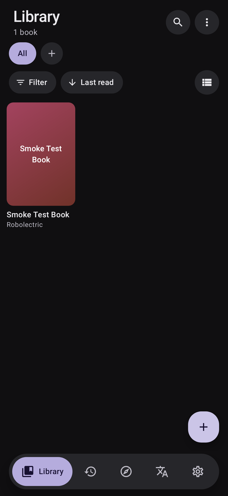
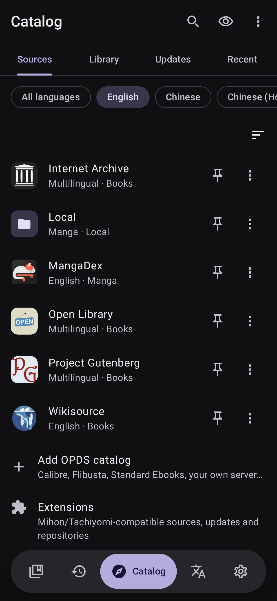
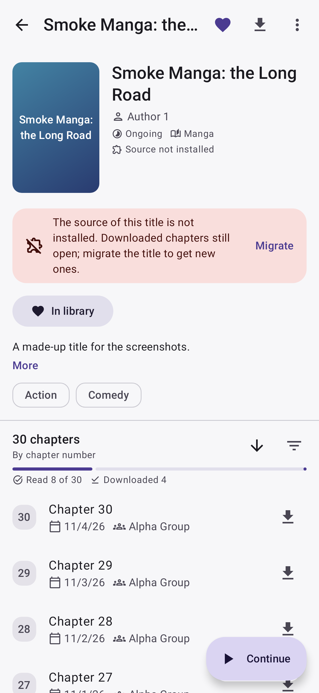
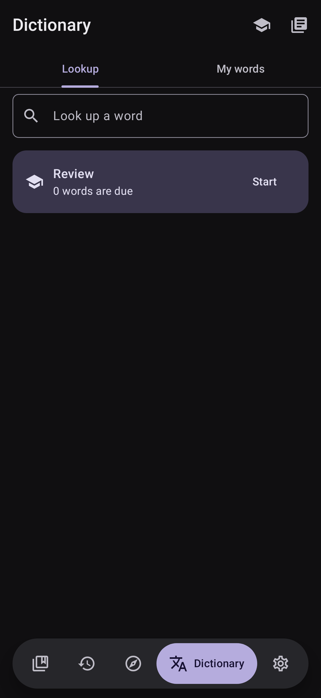
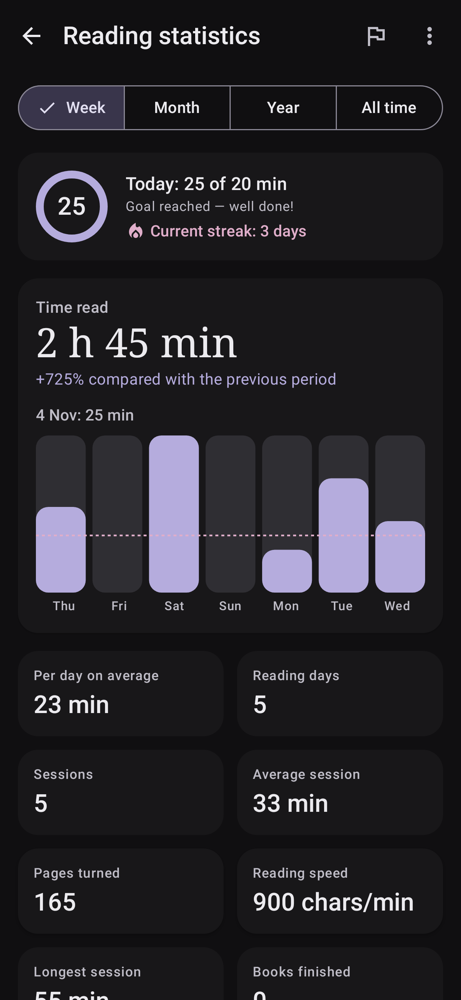
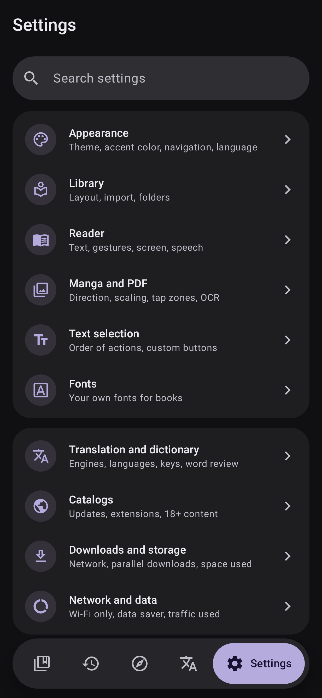
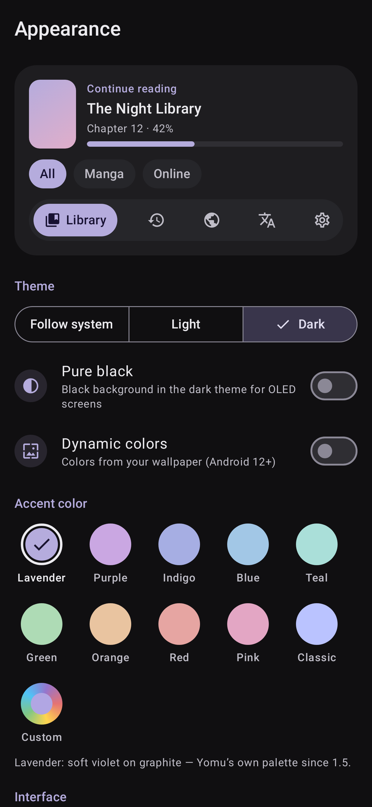
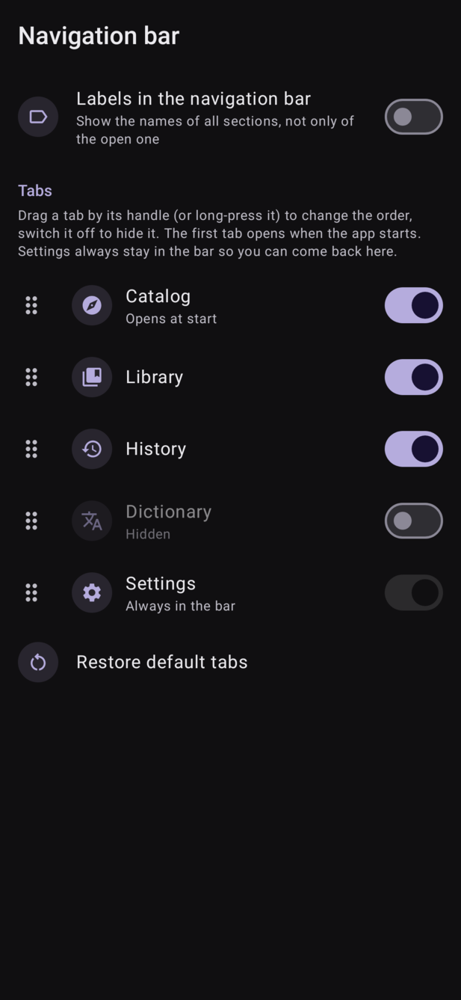
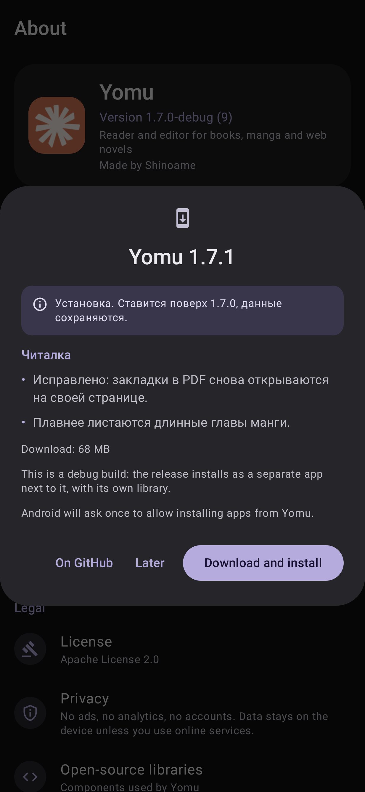
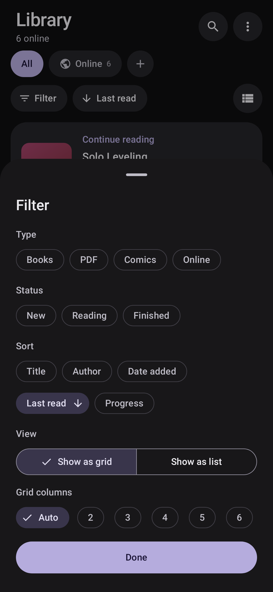

# Yomu

[](https://github.com/adxptived/yomu/actions/workflows/ci.yml)
[](https://github.com/adxptived/yomu/releases/latest)
[](https://github.com/adxptived/yomu/releases/tag/nightly)
[](https://github.com/adxptived/yomu/releases)
[](#license)

**Yomu** is an Android reader for books, PDFs, comics and manga, made for people who read in foreign languages. Tap any word to see it in a dictionary, translate sentences and pages, save words with their context and repeat them with flashcards. On top of that it includes a full book & manga editor and an online catalog with extensions.

No accounts, no ads, no telemetry. Your library stays on your device.

| Library | Catalog | Reader | Dictionary | Profile | Settings |
|---|---|---|---|---|---|
|  |  |  |  |  |  |

## Features

### Reading

- All the formats you are likely to have: EPUB, PDF, FB2, MOBI/AZW3, DOCX, TXT, HTML, CBZ/CBR/CB7 comics and plain image folders.
- A comfortable library: covers, metadata, custom shelves, tags, filters, sorting, "Continue reading" and bulk actions. Point the app at a folder and it keeps itself up to date.
- Text reading done properly: your own fonts, sizes and margins, light/dark/sepia/AMOLED themes, pages or continuous scroll, read-aloud with highlighting and a sleep timer, in-book search and table of contents.
- Manga and comics: right-to-left, vertical and webtoon modes, dual pages, zoom, image filters. PDFs: night mode, margin crop, passwords, and highlights that are saved into the PDF file itself so other apps see them too.
- DOCX gets a bonus **page layout** mode that shows the document as it will be printed: A4 pages, headers and footers, footnotes and tables.
- A profile with your reading time, streaks, achievements and detailed statistics — by day, hour and weekday.

### Dictionaries and translation

- Tap a word while reading to get its definition instantly — offline, thanks to bundled-format dictionaries (StarDict, DSL, JMdict, Wiktionary dumps).
- Translate a selection, a paragraph or a whole page: offline translation on the device (ML Kit) or online (Google, DeepL, LibreTranslate or your own OpenAI-compatible endpoint).
- Translate an entire book or build a bilingual edition with the original under each paragraph.
- OCR translates manga pages: speech bubbles are detected, translated and typeset right into the image.

### Words and notes

- Save words in one tap with the sentence they appeared in, then review them with spaced repetition (SM-2) until they stick. Export to CSV or Anki.
- Highlight in five colors, write Markdown notes with #tags, drop bookmarks, export quotes as shareable images.
- Everything is searchable and exports to Markdown (Obsidian-friendly), JSON, HTML, TXT and Readwise CSV.

### Editor

- Books: edit metadata and covers, restructure chapters, fix text and styles visually or in source mode, run regex find & replace, clean up typography, translate selected chapters.
- Manga: reorder, rotate and crop pages, fix colors, split spreads, recompress archives, edit ComicInfo.xml, and translate pages via OCR with typesetting.
- Works on a copy of the book until you decide to save.

### Catalog and downloads

- Built-in sources: OPDS (Project Gutenberg, Standard Ebooks, your Calibre/Kavita/Komga), Gutendex, Open Library / Internet Archive, plus novel sources RanobeLib and NovelBin.
- **Mihon/Tachiyomi extensions**: install sources from any extension repository, or use the five built-in ones (MangaDex, MANGA Plus, Webtoons, GlobalComix, AComics).
- Import your whole library from a Mihon/Tachiyomi backup, track titles with Shikimori, AniList and MyAnimeList.
- A download queue with pause and priorities, auto-download of new chapters, "download while reading" and full offline reading.

### Sync between devices

- Backups (manual and scheduled) plus sync through your own WebDAV server, a private GitHub repository or a shared folder: progress, highlights, notes, bookmarks, words and the online library — and, optionally, the book files themselves.
- Conflicts are resolved by you, in the app: changed files, edited image folders and book deletions appear on a dedicated "Sync conflicts" screen with clear actions. Changed copies are never overwritten or deleted silently.

| Appearance | Navigation | Updates | Library filters |
|---|---|---|---|
|  |  |  |  |

### Comfort

- Dark (default), light and AMOLED themes, eleven accent colors or Material You, seven app icons.
- PIN or biometric lock, incognito mode, EN/RU interface, phones and tablets, error log for bug reports.

## Download

Requires Android 8.0+.

- Get an APK from the [latest release](https://github.com/adxptived/yomu/releases/latest): `yomu-vX.Y.Z-arm64-v8a.apk` for phones and tablets, `yomu-vX.Y.Z-x86_64.apk` for emulators and x86 devices. Checksums are in `SHA256SUMS.txt`.
- Updates are built in: **Settings → About → Check for updates** downloads the APK for your device, verifies its SHA-256 and opens the installer. An optional daily check shows a dot on the Settings tab when a new version is out.
- Nightly builds from the latest `main` are also available.

Every release is signed with the same key, so updates install over each other. If your current copy came from a different key, Android will ask for a one-time clean install — make a backup first (Settings → Backup and sync).

## Building from source

Requires JDK 17 or 21 and an Android SDK (platform 36, build-tools 36). Set `sdk.dir` in `local.properties` or `ANDROID_HOME`.

```bash
./gradlew assembleDebug          # app/build/outputs/apk/debug/
./gradlew assembleRelease        # app/build/outputs/apk/release/ (R8 + shrinkResources)
./gradlew assembleFast           # debug app built like a release
./gradlew test                   # unit tests + the app's Robolectric smoke test
./gradlew :app:testDebugUnitTest -Proborazzi.test.record=true   # + screenshots into app/build/outputs/roborazzi
./gradlew detekt lint            # static analysis
```

Tracker OAuth keys are optional: pass `-PYOMU_ANILIST_CLIENT_ID=…` etc. at build time (see [docs/TRACKING.md](docs/TRACKING.md)); without them users enter their own keys in Settings → Tracking.

Release signing: without environment variables a release is signed with the local debug key; published APKs are signed by CI with the repository's secret keystore (`YOMU_KEYSTORE_BASE64`, `YOMU_KEYSTORE_PASSWORD`, `YOMU_KEY_ALIAS`, `YOMU_KEY_PASSWORD`). Tagging `vX.Y.Z` builds and publishes a release automatically; every green commit to `main` gets a `nightly` pre-release. See [docs/RELEASING.md](docs/RELEASING.md).

The build expects up to 4 GB of memory (`-Xmx2400m`, 2 workers).

## Extensions (for developers)

- **Mihon/Tachiyomi** extensions (lib 1.4 and 1.6) are loaded from user-added repositories — an `index.min.json`/`repo.json` URL, a GitHub page or an "Add to Mihon/Tachiyomi" link.
- **Yomu API**: implement `CatalogSource` from the `source-api` module and package it as an APK with the `yomu.extension.class` meta-data.

Details and signing checks: [docs/EXTENSIONS.md](docs/EXTENSIONS.md).

## Documentation

- [User guide](docs/USER_GUIDE.md) · [Changelog](CHANGELOG.md) · [Releasing](docs/RELEASING.md)
- [Architecture](docs/ARCHITECTURE.md) · [Decisions](docs/DECISIONS.md) · [Roadmap](docs/PROGRESS.md) · [Known limitations](docs/KNOWN_LIMITATIONS.md) · [Not done yet](docs/NOT_DONE.md)
- [Extensions](docs/EXTENSIONS.md) · [Tracking](docs/TRACKING.md) · [Privacy](docs/PRIVACY.md) · [Contributing](CONTRIBUTING.md)

## License

Yomu is free software: you can use, study, share and modify it under the [Apache License 2.0](LICENSE). In short: do what you like, including commercial use, as long as the license and copyright notice are preserved; the software comes with no warranty.

Third-party components keep their own licenses:

- **Apache-2.0** — AndroidX/Jetpack Compose, Kotlin, kotlinx.coroutines/serialization, Koin, OkHttp/Okio, Coil, Timber, Apache Commons Compress, RxJava, quickjs-java, PDFium (via `io.legere:pdfiumandroid`); the `compat/tachiyomi` compatibility layer and the built-in extensions are Mihon/Keiyoushi code (see the NOTICE files).
- **MIT** — Injekt, Jsoup, QuickJS.
- **BSD-3-Clause** — PDFium's original C library.
- **0BSD** — XZ for Java.
- **SIL OFL 1.1** — the Liberation and Carlito fonts used by the DOCX page layout.
- **UnRAR license** — junrar: decompression of RAR archives is permitted, creating RAR archives is not.
- **Proprietary** — Google ML Kit (offline translation, language identification, OCR) ships under Google's own terms; an ML Kit-free flavor is planned for F-Droid (see [KNOWN_LIMITATIONS](docs/KNOWN_LIMITATIONS.md)).

## Author

**Shinoame** — [github.com/adxptived](https://github.com/adxptived). Bug reports and ideas are welcome in [Issues](https://github.com/adxptived/yomu/issues/new/choose).
