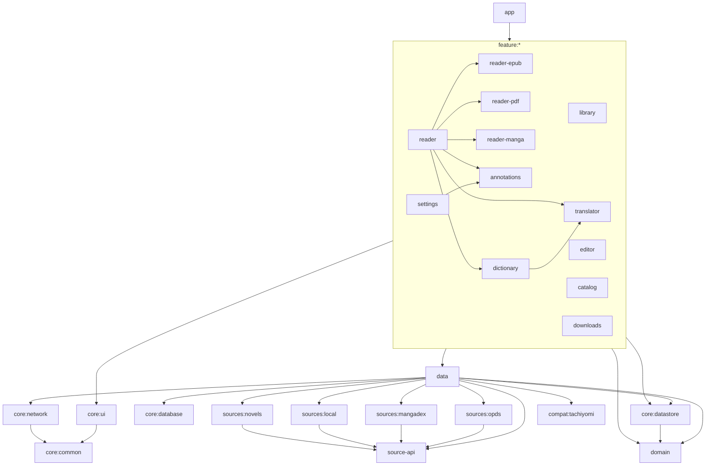

# Yomu architecture

A single Android app (Kotlin, Jetpack Compose, Material 3) with three modes: the **reader**, the **editor** and the **source catalog**. A multi-module Gradle project; shared module settings are convention plugins in `build-logic/`, versions live in `gradle/libs.versions.toml`.

## Modules



| Module | Type | Contents |
|---|---|---|
| `app` | Android app | `YomuApp` (Koin, Coil, notification channels, work scheduling), `MainActivity`, navigation (`navigation/`), onboarding, app lock, VIEW/SEND/PROCESS_TEXT intent handling, the "Continue reading" widget (`widget/`), tracker sign-in (`TrackLoginActivity`, the `yomu://…-auth` addresses), auto-sync (`AutoSync`) |
| `core:common` | Android lib | `UiState`, `AppError`, files/SAF, `Share`, the `ErrorLog` |
| `core:ui` | Android lib | theme (`YomuTheme`, accents, AMOLED), shared components (grids, sheets, dialogs, settings, empty/error states, hints), `KeyBus` for hardware buttons |
| `core:database` | Android lib | Room: entities, DAOs, FTS4 for the library, migrations |
| `core:datastore` | Android lib | `AppSettings` — every setting on DataStore Preferences, JSON export/import |
| `core:network` | Android lib | shared OkHttp clients (cache, timeouts, WebView cookies) |
| `domain` | Kotlin/JVM | models (books, locators, annotations, words, catalog), repository interfaces, SM-2, lemmatization, Japanese deinflection, find & replace, typography, annotation and word export |
| `data` | Android lib | import and metadata, containers (ZIP/RAR/7z/folder), the EPUB parser and writer, FB2/TXT/HTML/DOCX/MOBI → EPUB converters, PDF (PDFium), repositories, dictionaries (StarDict/DSL/JMdict/Wiktionary), translation (ML Kit + online engines), OCR, the catalog, extensions, downloads, WorkManager jobs, backup, Mihon import (`backup/MihonImporter`), Sync 2.0 (`SyncManager`, `SyncMerger`, `SyncBackends`: SAF folder / WebDAV), trackers (`tracking/`: Shikimori, AniList, MyAnimeList, Kitsu, MangaUpdates), PDF annotation writing (`book/pdf/`: a custom JVM PDF parser and incremental writer) |
| `source-api` | Kotlin/JVM | the public source API for extensions (`Source`, `CatalogSource`, `HttpSource`, models, filters) |
| `sources:*` | Kotlin/Android | OPDS (+ Gutendex, Open Library/Internet Archive), MangaDex, a local folder, novels (`sources:novels`: RanobeLib, NovelBin) |
| `compat:tachiyomi` | Android lib | the public Mihon/Tachiyomi extension API (`eu.kanade.tachiyomi.*`, lib 1.4/1.6: sources, models, filters, `NetworkHelper`, interceptors, `JavaScriptEngine`), an Injekt graph for extensions, an Rx ↔ coroutines bridge |
| `feature:library` | Android lib | the library (Paging, grid/list, filters, collections, bulk actions), the book card |
| `feature:reader*` | Android lib | the shared reading screen (overlay, settings, TTS, search, contents, statistics) and engines: EPUB (WebView + JS), PDF (PDFium + zoom), manga (pages/feed/webtoon) |
| `feature:annotations` | Android lib | highlights, notes, bookmarks, quotes, export/import |
| `feature:dictionary`, `feature:translator` | Android lib | word search, my words, repetition, dictionaries; selection translation, language packs, book translation |
| `feature:editor` | Android lib | the EPUB editor (metadata, chapters, contents, visual `VisualEditor`, XHTML/CSS, find & replace, cleanup, images, validation, selected-chapter translation) and the manga editor (pages, cropping, colors, spreads, ComicInfo, page translation: `Typeset`, `MangaTypesetUi`) with undo/redo |
| `feature:catalog` | Android lib | sources, browse/search with filters, a title and chapters, favorites and tabs, updates, history, global search, migration, extensions, WebView |
| `feature:downloads` | Android lib | the download queue, pause/retry, storage |
| `feature:settings` | Android lib | every settings section, fonts, locking, backup/sync, the error log, "About" |

## Layers and data flow

```
Compose UI  ──events──▶  ViewModel (StateFlow<UiState>)  ──▶  Repository / Service (data)  ──▶  Room · DataStore · files · network
     ▲                              │
     └────────── state ─────────────┘
```

- **UI** — Compose only; screens get ViewModels via `koinViewModel()` (route parameters — `parametersOf`).
- **ViewModels** hold a `StateFlow` of state, one-shot events go through a `Channel`; long operations — `viewModelScope` + `Dispatchers.IO`.
- **Errors** are mapped to `AppError` (`AppError.from`, `runCatchingApp`) and shown by `ErrorState`/a snackbar; unhandled exceptions go to `ErrorLog` (the "Error log" screen).
- **DI** — Koin: a module per feature + `dataModule` + `appModule`; the list is `yomuModules` in `YomuApp.kt`.

### Book import
`SAF Uri / file → FormatDetector (signature + extension) → MetadataExtractor (cover, author, series, language) → [EPUB conversion for FB2/TXT/HTML/DOCX/MOBI] → BookEntity (Room) → library (Paging)`. "Copy" and "link" modes; duplicates are matched by the file's SHA-1 prefix + size. Folder scanning — `LibraryScanWorker`.

### Reading
`ReaderRoute(bookId, locator) → ReaderViewModel → an engine by format (EPUB/PDF/manga)`. The position is a `Locator` (chapter, progress, text offset); saved with debounce and on exit; reading sessions (`reading_sessions`) are written for history and statistics (`ReadingHistoryRepository`, `StatsCalculator`). DOCX additionally opens in "Page layout": `DocxLayout` (DOCX → HTML with page geometry) + `paginate.js` in a WebView (`DocxLayoutScreen`). Text selection → the floating panel (customizable actions: copy, color, note, dictionary, translate, speak, search, share, custom URLs/apps).

### Dictionary and translation
A word tap → `Lemmatizer`/`JapaneseDeinflector` → offline dictionaries (Room) → an online dictionary (if allowed) → translation (ML Kit offline or the chosen online engine; a translation cache) → "Save word" with the context sentence → SM-2 repetition.

### Catalog
`SourceManager` (built-ins + OPDS + the local folder + extensions; a language filter) → `CatalogRepository.browse/search` (Paging) → title and chapters into Room → downloading (`DownloadRepository` + `DownloadWorker`, a foreground service) → offline reading. `UpdateWorker` checks new chapters of favorites.

Extensions: `ExtensionStores` reads repositories (the legacy `index.min.json` + `repo.json`, index v2 protobuf/JSON), `ExtensionManager` installs APKs into a private (read-only) folder or finds installed packages, verifies signatures, loads classes (`DelegateLastClassLoader` from Mihon) and wraps Mihon/Tachiyomi sources into `TachiyomiSource`; built-in APKs are copied from `assets/extensions` at startup.

### Editor
`EditorViewModel` unpacks a book into a working folder (`EpubWorkspace` / `MangaWorkspace`); every change is a `History` step (before/after snapshots of the affected files, surviving restarts). "Save" packs the EPUB/CBZ (mimetype first, uncompressed), validates it with the parser and replaces the original or saves a copy.

### Background work (WorkManager)
`LibraryScanWorker`, `DownloadWorker`, `UpdateWorker`, `BackupWorker`, `SyncWorker`, `ReminderWorker`, `BookTranslationWorker`, `PdfAnnotationWorker` (highlights → the PDF file, 2 s after a change) — `WorkScheduler` schedules them from settings.

## Storage

- `files/books` — copied books, `files/converted` — EPUB copies of converted formats, `files/covers` — covers, `files/downloads` — chapters and books from the catalog, `files/editor` — editor drafts and their history, `files/dict` — dictionary data.
- The Room database is `yomu.db`; settings — the DataStore `settings.preferences_pb`.
- A backup is a ZIP: `backup.json` (tables + settings) and optionally `files/`.
