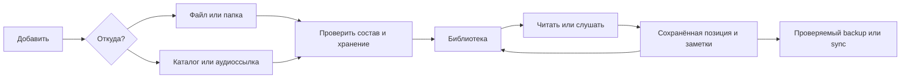
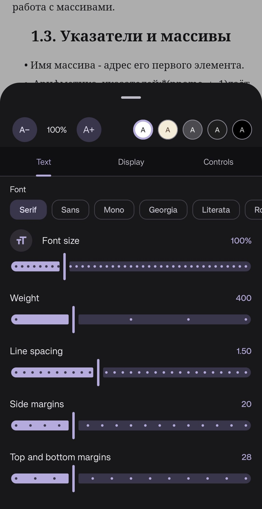

# Аудит UX и продуктовых возможностей Yomu

Дата: **13 ноября 2026**. Срез кода: **`cf2ff1e`**, рабочая копия перед аудитом чистая.

Цель: сделать приложение понятным при первом запуске, удобным для ежедневного чтения и прослушивания; определить полезные недостающие возможности по коду Yomu и обратной связи о других приложениях.

Быстрые переходы: **[настройки внутри читалок и бесконечная лента](#15-дополнение-настройки-внутри-читалок-и-непрерывные-режимы)** · [конкуренты и отзывы](#5-конкуренты-функции-и-отзывы) · [карта кода](#6-карта-кода-для-выполнения-рекомендаций) · [карточки UX](#7-изменения-существующего-ux) · [новые функции](#8-новые-возможности-что-добавлять-и-в-каком-объёме) · [порядок работ](#10-порядок-реализации-и-зависимости) · [проверка](#11-проверка-и-критерии-удобства).

**Дополнение по обратной связи пользователя:** раздел 15 подробно разбирает панель настроек непосредственно во время чтения, предоставленный снимок телефона и режимы прокрутки книг/манги/PDF. Его кодовая проверка выполнена на HEAD `86ca462`; основной аудит выше привязан к `cf2ff1e`. Остальные карточки не объявляются автоматически перепроверенными на новом HEAD.

## 1. Главные выводы

Yomu уже обладает большой частью функций, ради которых устанавливают отдельные читалки, менеджеры манги, словари и аудиоплееры. Главный резерв улучшения — **связать существующие возможности в короткие, предсказуемые сценарии**. Расширять приложение стоит после устранения препятствий на пути «добавить → открыть → настроить → продолжить → сохранить результат».

Первыми следует сделать:

1. Понятную навигацию с подписями и первый запуск с выбором задачи.
2. Ясный импорт: файл, папка одной книги, наблюдаемая библиотека; объяснение копирования и доступа к оригиналу; подробный результат.
3. Защиту набранных заметок и понятное подтверждение сохранения.
4. Удобную работу с аудиокнигами: фиксировать момент закладки при нажатии, возвращаться после случайной перемотки, показывать готовность к офлайну.
5. Честное описание состава синхронизации и резервной копии. Аудиозакладки сейчас хранятся отдельно от обычных закладок и не представлены в рассмотренной модели синхронизации.
6. Упростить массовые действия, настройку словарей, работу с источниками и переход между устройствами.
7. Перестроить **настройки внутри книги и манги**: короткая панель частых действий, удобный предпросмотр, осмысленные значения вместо полотна ползунков; явный выбор листания/ленты и бесшовное продолжение через главы. Это основной сценарий чтения и ближайший приоритет, а не поздняя косметическая задача. Подробности — UX23–UX28 и F12–F16 в разделе 15.

Новые функции с наибольшим потенциалом: история перемещений аудиоплеера, умные полки, навигация по сериям, управляемый автооткат аудио. Следующий уровень — доступные пресеты, нормализация громкости, полноценная автомобильная библиотека и интеграция с аудиосервером. Автоматическая синхронизация текста с произвольной аудиозаписью — отдельный дорогой проект, а не небольшое дополнение к плееру.

## 2. Методика и границы достоверности

Выполнены: чтение экранов, моделей, маршрутов, импорта, аудио, настроек и синхронизации; просмотр **9 существующих PNG** из `docs/screenshots` — `library`, `onboarding`, `chapters`, `catalog`, `dictionary`, `settings`, `stats`, `library-filters`, `nav-settings`; изучение описаний функций, пользовательских отзывов и обращений по конкурентам.

**Приложение в этом проходе на телефоне или эмуляторе не запускалось.** Скриншоты — материалы репозитория, часть из них старше текущего кода: например, старые изображения ещё показывают History вместо нынешнего Profile и не содержат некоторых новых настроек. Это иллюстрации устройства интерфейса, а не доказательство текущего состояния каждого экрана. Новая сборка, TalkBack, реальные аккаунты, WebDAV, Android Auto и аппаратное воспроизведение не проверялись. Цветовой контраст и задержки не измерялись. Предлагаемые численные цели ниже — критерии для будущей проверки, не полученные результаты.

Обозначения:

| Метка | Значение |
|---|---|
| **К** | Факт виден в текущем коде. Пользовательское влияние оценено экспертно, без воспроизведения на устройстве. |
| **Г** | UX-гипотеза: нужно проверить прототипом или наблюдением за пользователями. |
| **Н** | Предлагаемая новая возможность; отсутствие относится к рассмотренным моделям и сценариям. |
| **О** | Сигнал из внешнего отзыва или обращения. Это не доказательство дефекта Yomu. |

Приоритеты: **P1** — препятствие основному сценарию, риск потери работы или непонимания сохранности данных; **P2** — заметное сокращение усилий при регулярном использовании; **P3** — дополнительная ценность для отдельной аудитории. P1 здесь — продуктовая оценка, не обозначение воспроизведённого падения.

Стоимость дана относительно: **S** — ограниченная правка UI/состояния; **M** — несколько экранов или изменение хранения; **L** — новая подсистема/миграция/внешняя интеграция. Это не обещание сроков.

Аудит [от 12 ноября](AUDIT_2026-11-12.md) использован как исторический указатель. Текущий HEAD содержит отдельный коммит с исправлениями того аудита. Старые проблемы не перенесены сюда автоматически как открытые.

## 3. Для кого проектировать сценарии

| Пользователь | Основная задача | Что должно быть очевидно |
|---|---|---|
| Читатель локальных книг | Открыть скачанный EPUB/FB2/PDF и продолжить завтра | Где книга, как увеличить текст, где остановился, останутся ли заметки |
| Читатель манги/вебтунов | Найти серию, подписаться, получать главы и читать без сети | Разница источника и библиотеки, следующая глава, загруженные главы, восстановление источника |
| Слушатель | Добавить папку/M4B/ссылку и слушать с заблокированным экраном | Книга или трек, текущая глава, таймер, офлайн, безопасная перемотка |
| Изучающий язык | Узнать слово без выхода из книги и повторить его позже | Как получить словарь, сохранить слово с контекстом, где повторение |
| Пользователь двух устройств | Продолжить на другом телефоне/планшете | Что синхронизировалось, когда, откуда взялся конфликт, есть ли сами файлы |
| Пользователь большого шрифта/TalkBack | Выполнить те же задачи без точных жестов | Подписанные действия, порядок фокуса, отсутствие обрезанного текста |

Режимы «Читать», «Манга», «Слушать», «Учить язык» должны быть **предложениями стартовых настроек**, а не четырьмя разными библиотеками. Выбор можно изменить; остальные функции остаются доступны.

## 4. Что уже есть: не создавать повторно

| Возможность | Основание в проекте | Вывод |
|---|---|---|
| Полки, теги, статусы, фильтры, поиск, продолжение, массовое редактирование | `LibraryScreen`, `LibraryViewModel`, `BatchMetadataDialog`, `Book.kt` | Нужны ясная организация и быстрый доступ, а не ещё одна базовая библиотека |
| EPUB/PDF/комиксы, собственные шрифты, темы и пресеты | `ReaderSettingsSheet`, `TextPresets`, движки `reader-*` | Сохранить возможности, сделать понятнее область применения |
| Настройки жестов, схема зон касания, разовые подсказки | `ReaderTapZonesHint`, `ReaderScreen:531`, `ReaderSettingsSheet:736` | Доработать повторный показ и доступные альтернативы, не объявлять обучение отсутствующим |
| Возврат после перехода в текстовой читалке | `ReaderScreen:686`, `ReaderPositionUi` | Похожую защиту нужно добавить аудио; текстовый возврат уже существует |
| Поиск настроек приложения с переходом к строке | `SettingsSearch:40,84`, `SettingsScreen` | Улучшать полноту индекса и язык поиска |
| Заметки Markdown, выделения, закладки, экспорт, отмена удаления | `AnnotationsScreen`, `NoteDialog`, `AnnotationsViewModel` | Основные пробелы — черновики, подтверждение записи, обнаружимость общего списка |
| Словари, перевод, сохранение слов, SRS и экспорт | `feature/dictionary`, `feature/translator`, `domain/srs` | Упростить первый полезный результат |
| Аудио MP3/M4B и другие форматы, главы, закладки, скорость, пропуск тишины | `Audio.kt`, `AudioSettings`, `AudioPlayerScreen` | Это уже полноценная основа, не пустой плеер |
| Таймер аудио, конец главы, продление, плавное затихание, остаток с учётом скорости | `AudioPlayerScreen:253`, `AudioPlaybackService:513`, `AudioPlayerViewModel:176` | Улучшить управление и видимость; не добавлять повторно |
| Автооткат аудио после паузы | `AudioPlaybackService:653` | Настраивать существующее правило, а не писать функцию заново |
| Мини-плеер, медиасессия, фоновые аудиозагрузки | `NowPlayingBar`, `YomuNavigation:207`, `AudioPlaybackService`, `Downloads` | Проверять сквозные сценарии и управление вне плеера |
| Загрузки аудио в общем экране очереди | `Downloads:210,655` | Не нужен второй независимый центр загрузок |
| Импорт Mihon/Tachiyomi и смена источника | `MihonImporter`, `GlobalSearchScreen`, `CatalogViewModels:818` | Нужны предпросмотр, совместимость и понятный отчёт |
| Резервные копии, WebDAV/GitHub/папка, экран конфликтов | `SettingsV2`, `BackupManager`, `SyncProblemsSection` | Сделать настройку и состав переносимых данных понятными |
| Виджет продолжения чтения | `app/.../widget/ContinueReadingWidget.kt` | Отдельно оценить аудиоуправление; не считать все виджеты отсутствующими |
| PDF reflow и запись PDF-аннотаций | `PdfReflow`, `PdfAnnotationWriter`, `PdfSettings` | Проверять сложные/сканированные документы; не предлагать заново весь PDF-режим |

## 5. Конкуренты: функции и отзывы

### 5.1. Выбор приложений и ограничения выборки

Изучены **Tachiyomi, Mihon, ReadEra, Moon+ Reader, Librera**, а также **Smart AudioBook Player, Listen Audiobook Player и Voice Audiobook Player**. Две дополнительные текстовые читалки выбраны за локальную библиотеку, богатые настройки и TTS; три аудиоплеера — за близость к сценарию собственных файлов Yomu.

Tachiyomi рассматривается как исторический ориентир и источник ожиданий при миграции: прекращение активной разработки объявлено **13 января 2024**. Это подтверждает [официальная организация](https://github.com/tachiyomiorg). Его нельзя описывать как активно развивающегося конкурента 2026 года.

Выборка качественная: **19 конкретных отзывов/обращений** — R01–R18 ниже и R19 в разделе 15.2. Это видимая веб-выборка, а не выгрузка всех отзывов, не случайная выборка и не измерение частоты жалоб. В ней есть старые отзывы; их дата указана. Старое обращение показывает пользовательскую потребность, а не доказывает, что проблема осталась в сегодняшней версии конкурента. Рейтинги и число установок не использованы для расстановки приоритетов.

### 5.2. Что полезно взять у конкурентов

| Приложение | Подтверждённые ориентиры | Что применить к Yomu |
|---|---|---|
| Tachiyomi, исторический ориентир | Библиотека и история были ценными переносимыми данными; восстановление записей пользователь воспринимает вместе с доступом к скачанному | Мастер переноса должен различать записи библиотеки, источники и реальные файлы. [Обращение о восстановлении](https://www.reddit.com/r/mangapiracy/comments/191sb7g/help_how_to_reattach_local_files_to_library_in/) |
| Mihon | Вход через источники, добавление в библиотеку, миграция с выбором данных, резервные копии; скачанные главы не входят в обычный backup. Официальная FAQ отдельно отличает backup от межустройственной синхронизации | Сохранить знакомый путь для мигрантов, но объяснять ограничения раньше. Yomu не нужно копировать отсутствие sync. [Старт](https://mihon.app/docs/guides/getting-started), [миграция](https://mihon.app/docs/guides/source-migration), [backup](https://mihon.app/docs/guides/backups), [FAQ](https://mihon.app/docs/faq/library) |
| ReadEra | Автообнаружение, авторы/серии, коллекции, восстановление позиции, история переходов, несколько документов | Быстрый старт и сохранность работы важнее количества кнопок. Серии должны стать действием, а не только метаданными. [Описание и отзывы](https://play.google.com/store/apps/details?id=org.readera&hl=en) |
| Moon+ Reader | Настраиваемые действия, темы, словарь, облачные backup/позиции, линейка чтения, аппаратные кнопки | Оставить тонкую настройку, дополнить простыми пресетами и восстановлением стандартного вида. [Описание и отзывы](https://play.google.com/store/apps/details?id=com.flyersoft.moonreader&hl=en) |
| Librera | Настраиваемые зоны, TTS, внешние словари, PDF reflow, папки, разные режимы чтения | Избегать панели со всеми настройками сразу; отдельно объяснять ограничения текста в PDF. [Описание и отзывы](https://play.google.com/store/apps/details?id=com.foobnix.pdf.reader&hl=en) |
| Smart AudioBook Player | История воспроизведения, отдельный прогресс книг, закладки, список персонажей, таймер | Возврат после случайного прыжка и ясное состояние таймера. [Описание и отзывы](https://play.google.com/store/apps/details?id=ak.alizandro.smartaudiobookplayer&hl=en) |
| Listen Audiobook Player | История позиции, регулируемый автооткат, очередь книг, обработка громкости, Android Auto, Audiobookshelf | Настраиваемое восстановление контекста и прозрачная синхронизация; интеграции — после основной надёжности. [Описание и отзывы](https://play.google.com/store/apps/details?id=com.acmeandroid.listen&hl=en) |
| Voice Audiobook Player | Простое добавление папок, возврат после прыжка, история, таймер, виджеты, Android Auto | Спокойный главный плеер, исправляемое название книги, понятные дополнительные настройки. [Описание и отзывы](https://play.google.com/store/apps/details?id=de.ph1b.audiobook&hl=en) |

### 5.3. Конкретные сигналы из отзывов и обращений

Все пересказы ниже — своими словами. Ссылки Google Play ведут на страницу приложения с видимой секцией отзывов; конкретный отзыв нужно искать по имени и дате. Набор отображаемых отзывов зависит от региона и языка.

| ID | Приложение, автор, дата | Наблюдение из источника | Вывод для Yomu |
|---|---|---|---|
| R01 | Tachiyomi, автор поста, январь 2024, версия 0.15.1 | После restore библиотека видна, а существующие загрузки перестали распознаваться | Проверять файлы и доступ к папкам после переноса, предлагать перепривязку. [Пост](https://www.reddit.com/r/mangapiracy/comments/191sb7g/help_how_to_reattach_local_files_to_library_in/) |
| R02 | Mihon, Santhosh-MJ, 30.10.2026 | Непонятно, какую главу откроет Resume | Показывать цель продолжения и переход к текущей главе в списке. [Issue #4216](https://github.com/mihonapp/mihon/issues/4216) |
| R03 | Mihon, LetianLi, 17.06.2026 | Обновление библиотеки не соответствует ожиданиям от активных поиска/фильтров | Явно подписывать область действия массовой команды. [Issue #3425](https://github.com/mihonapp/mihon/issues/3425) |
| R04 | ReadEra, M W, 11.04.2026 | Хвалит настройку текста, сохранение страницы и словарь | Эти существующие возможности Yomu должны открываться без изучения настроек. [Отзывы](https://play.google.com/store/apps/details?id=org.readera&hl=en) |
| R05 | ReadEra, Kai Margaux, 09.04.2026 | Хвалит простой офлайн-интерфейс, сообщает о несохранившихся заметках | Явное состояние сохранения и восстановимый черновик. Сообщение пользователя не устанавливает причину сбоя. [Отзывы](https://play.google.com/store/apps/details?id=org.readera&hl=en) |
| R06 | ReadEra, A Google user, 19.02.2020 | Не нашёл работу с заметками; после ответа поддержки нашёл нужное | Наличие функции не означает её обнаружимость. [Отзыв и ответ](https://play.google.com/store/apps/details?id=org.readera&hl=en) |
| R07 | Moon+, A Google user, 12.10.2019 | Неудачная разбивка текста в портретной ориентации | Проверять читаемость реальными файлами и сменой ориентации. [Отзывы](https://play.google.com/store/apps/details?id=com.flyersoft.moonreader&hl=en) |
| R08 | Moon+, C. W., 26.12.2022 | Возникли трудности выдачи доступа к файлам при использовании экранного фильтра | Нужна объяснимая ошибка доступа и повтор выбора, а не вывод «книга повреждена». [Отзывы](https://play.google.com/store/apps/details?id=com.flyersoft.moonreader&hl=en) |
| R09 | Librera, Matthew Bedford, 10.02.2022 | Чтение устраивает, библиотека перегружена параметрами | Отделять частые действия от расширенных. [Отзывы](https://play.google.com/store/apps/details?id=com.foobnix.pdf.reader&hl=en) |
| R10 | Librera, A Google user, 25.10.2018 | Сообщает об изменении позиции при повороте | Критерий сохранения текстового якоря при переразметке. [Отзывы](https://play.google.com/store/apps/details?id=com.foobnix.pdf.reader&hl=en) |
| R11 | Librera, Hobo_Shuruken, 02.06.2021 | TTS смешивает колонки учебного PDF | Предпросмотр порядка чтения и честное сообщение о скане/колонках. [Отзывы](https://play.google.com/store/apps/details?id=com.foobnix.pdf.reader&hl=en) |
| R12 | Smart ABP, A Google user, 30.09.2019 | Автооткат полезен после долгой паузы, мешает после короткого прерывания | Настройка порога и причины отката. [Отзывы](https://play.google.com/store/apps/details?id=ak.alizandro.smartaudiobookplayer&hl=en) |
| R13 | Smart ABP, A Google user, 26.10.2018 | Затихание таймера воспринято как неисправность громкости; разработчик объяснил таймер | Перед затиханием показывать понятное состояние с отменой. [Отзыв и ответ](https://play.google.com/store/apps/details?id=ak.alizandro.smartaudiobookplayer&hl=en) |
| R14 | Listen, Jamie Cameron, 19.07.2026 | Сообщает, что позиция между устройствами не синхронизируется; разработчик поясняет задержку после паузы | Показывать последнюю успешную отправку и ручное действие. Не делать вывод, что sync конкурента вообще не работает. [Отзыв и ответ](https://play.google.com/store/apps/details?id=com.acmeandroid.listen&hl=en) |
| R15 | Listen, Crash, 13.06.2026 | Ценит стабильную простую компоновку и доступные настройки | Улучшать плеер без постоянной смены привычных кнопок. [Отзывы](https://play.google.com/store/apps/details?id=com.acmeandroid.listen&hl=en) |
| R16 | Listen, Jacob Sullivan, 12.09.2026 | Проблему входа Plex сначала отнёс к приложению, затем сообщил о восстановлении | Различать недоступность сервера, истечение входа и ошибку приложения. [Отзывы](https://play.google.com/store/apps/details?id=com.acmeandroid.listen&hl=en) |
| R17 | Voice, Dorian LaRue, 15.10.2025 | Некорректно выбранные теги мешают отличать книги одной серии | Предпросмотр имени при импорте и ручное исправление без изменения файлов. [Отзывы](https://play.google.com/store/apps/details?id=de.ph1b.audiobook&hl=en) |
| R18 | Voice, A Google user, 27.04.2019 | Не устраивают обязательная группировка, автозаголовки и крупные плитки | Сохранять выбор пользователя, разрешать плотность списка и название из папки. [Отзывы](https://play.google.com/store/apps/details?id=de.ph1b.audiobook&hl=en) |

Из этой выборки вытекают пять устойчивых **тем для проектирования**, а не статистически доказанных «самых частых жалоб»: сохранность позиции и заметок; ясный импорт; управляемая сложность; объяснимое состояние фоновой работы; возможность отменить ошибочное действие.

### 5.4. Важная совместимость Mihon

На дату исследования [официальный changelog Mihon](https://mihon.app/changelogs/) называет ветку 0.21 последней с поддержкой старого `.tachibk` и расширений Tachiyomi 1.4 в следующем major-переходе. Это объявление о границе совместимости, а не доказательство поддержки Yomu ещё не проверенного нового формата.

`MihonImporter.kt:25` Yomu явно описывает gzip/protobuf `.tachibk`/`.proto.gz` и пропуск неизвестных полей. В интерфейсе нужны конкретные поддерживаемые форматы и версия проверенного экспортёра; реальный файл новой версии следует проверять до обещания совместимости. Не писать «поддерживает любой backup Mihon».

## 6. Карта кода для выполнения рекомендаций

Пути ниже относительно корня репозитория; строки соответствуют указанному HEAD. Сокращения используются в карточках раздела 7.

| Код | Файл / основные точки |
|---|---|
| C01 | [AppSettings.kt](../core/datastore/src/main/kotlin/app/yomu/core/datastore/AppSettings.kt):96 — подписи; [YomuNavigation.kt](../app/src/main/kotlin/app/yomu/navigation/YomuNavigation.kt):149,207,353,386,399,528 — маршруты и оболочка |
| C02 | [Onboarding.kt](../app/src/main/kotlin/app/yomu/ui/Onboarding.kt):70,90,109 — первый запуск и разрешения |
| C03 | [LibraryScreen.kt](../feature/library/src/main/kotlin/app/yomu/feature/library/LibraryScreen.kt):267,305,438,524,800,1125 — импорт, смешанная библиотека, действия, фильтры |
| C04 | [LibraryViewModel.kt](../feature/library/src/main/kotlin/app/yomu/feature/library/LibraryViewModel.kt):125,345,370; [ImportService.kt](../data/src/main/kotlin/app/yomu/data/library/ImportService.kt):44,137,174 — результаты и идентификация |
| C05 | [BookDetailsScreen.kt](../feature/library/src/main/kotlin/app/yomu/feature/library/BookDetailsScreen.kt):242,273,345,461; [Book.kt](../domain/src/main/kotlin/app/yomu/domain/model/Book.kt):70,75 — серии, коллекции, фильтры |
| C06 | [CatalogScreen.kt](../feature/catalog/src/main/kotlin/app/yomu/feature/catalog/CatalogScreen.kt):150,202,262; [TitleScreen.kt](../feature/catalog/src/main/kotlin/app/yomu/feature/catalog/TitleScreen.kt):444,520 — источники и главы |
| C07 | [GlobalSearchScreen.kt](../feature/catalog/src/main/kotlin/app/yomu/feature/catalog/GlobalSearchScreen.kt):124,143,177; [CatalogViewModels.kt](../feature/catalog/src/main/kotlin/app/yomu/feature/catalog/CatalogViewModels.kt):753,818 — поиск и миграция |
| C08 | [SettingsScreen.kt](../feature/settings/src/main/kotlin/app/yomu/feature/settings/SettingsScreen.kt):104; [SettingsSearch.kt](../feature/settings/src/main/kotlin/app/yomu/feature/settings/SettingsSearch.kt):40,50,84 — структура и поиск |
| C09 | [ReaderSettingsSheet.kt](../feature/reader/src/main/kotlin/app/yomu/feature/reader/ReaderSettingsSheet.kt):122,139,171,370,736 — вкладки, область настроек, шрифты, управление |
| C10 | [ReaderScreen.kt](../feature/reader/src/main/kotlin/app/yomu/feature/reader/ReaderScreen.kt):478,531,686,757,811; [ReaderDialogs.kt](../feature/reader/src/main/kotlin/app/yomu/feature/reader/ReaderDialogs.kt):159,234 — восстановление, жесты, заметки, TTS |
| C11 | [NoteDialog.kt](../feature/annotations/src/main/kotlin/app/yomu/feature/annotations/NoteDialog.kt):46,56,91; [AnnotationsScreen.kt](../feature/annotations/src/main/kotlin/app/yomu/feature/annotations/AnnotationsScreen.kt):174,367; [AnnotationsViewModel.kt](../feature/annotations/src/main/kotlin/app/yomu/feature/annotations/AnnotationsViewModel.kt):90,196 — запись и общий список |
| C12 | [DictionaryScreen.kt](../feature/dictionary/src/main/kotlin/app/yomu/feature/dictionary/DictionaryScreen.kt):100; [DictionariesScreen.kt](../feature/dictionary/src/main/kotlin/app/yomu/feature/dictionary/DictionariesScreen.kt):60,106; [TranslationSheet.kt](../feature/translator/src/main/kotlin/app/yomu/feature/translator/TranslationSheet.kt):107 — обучение и пакеты |
| C13 | [AudioPlayerScreen.kt](../feature/audio/src/main/kotlin/app/yomu/feature/audio/AudioPlayerScreen.kt):156,178,253,304,382,504,563; [AudioPlayerViewModel.kt](../feature/audio/src/main/kotlin/app/yomu/feature/audio/AudioPlayerViewModel.kt):106,125,133,148 — плеер, закладки, ошибки |
| C14 | [AudioSettings.kt](../feature/audio/src/main/kotlin/app/yomu/feature/audio/AudioSettings.kt):18,21; [AudioPlaybackService.kt](../feature/audio/src/main/kotlin/app/yomu/feature/audio/AudioPlaybackService.kt):71,224,420,513,653 — сохранение аудио, таймер, откат |
| C15 | [Downloads.kt](../feature/downloads/src/main/kotlin/app/yomu/feature/downloads/Downloads.kt):210,308,655; [AudiobookDownloader.kt](../data/src/main/kotlin/app/yomu/data/audio/AudiobookDownloader.kt) — очередь и офлайн |
| C16 | [SettingsSections.kt](../feature/settings/src/main/kotlin/app/yomu/feature/settings/SettingsSections.kt):957; [SettingsV2.kt](../feature/settings/src/main/kotlin/app/yomu/feature/settings/SettingsV2.kt):105; [SyncProblemsSection.kt](../feature/settings/src/main/kotlin/app/yomu/feature/settings/SyncProblemsSection.kt) — backup и sync |
| C17 | [SyncModels.kt](../data/src/main/kotlin/app/yomu/data/backup/SyncModels.kt):10,78; [SyncMerger.kt](../data/src/main/kotlin/app/yomu/data/backup/SyncMerger.kt):77; [MihonImporter.kt](../data/src/main/kotlin/app/yomu/data/backup/MihonImporter.kt):25 — состав переноса |
| C18 | [ProfileScreen.kt](../app/src/main/kotlin/app/yomu/profile/ProfileScreen.kt):120,140,213; [EditorScreen.kt](../feature/editor/src/main/kotlin/app/yomu/feature/editor/EditorScreen.kt):76,115,154 — второстепенные сценарии |
| C19 | [Dimens.kt](../core/ui/src/main/kotlin/app/yomu/core/ui/theme/Dimens.kt):8; [Theme.kt](../core/ui/src/main/kotlin/app/yomu/core/ui/theme/Theme.kt); [MangaReaderView.kt](../feature/reader-manga/src/main/kotlin/app/yomu/feature/reader/manga/MangaReaderView.kt):193 — визуальная система и развороты |

## 7. Изменения существующего UX

### UX01. Подписать навигацию и согласовать названия

**P1 · S · К/Г. Где:** C01, C18. `navLabels` по умолчанию `false`; HISTORY в модели ведёт в Profile. В старых скриншотах неактивные вкладки показаны только иконками. Словарь визуально легко принять за переводчик; часы не объясняют профиль со статистикой и загрузками.

**Что сделать:** показывать подписи всех основных разделов для новых установок: «Библиотека», «Каталог», «Слова», «Профиль», «Настройки». «Слова» проверить рядом с «Словарь» на прототипе. Скрытие подписей оставить явной настройкой; существующий выбор сохранить. Для большой системной гарнитуры использовать стандартную вертикальную компоновку значка с подписью, а не сжимать пять текстов в одну строку. Внутренний enum не обязательно переименовывать в этой задаче, чтобы не сломать сохранённые настройки.

**Приёмка:** новичок находит историю и словарь без перебора вкладок; все пять названий доступны TalkBack; RU/EN, 320 dp и fontScale 2.0 не скрывают действия. Проверить изменение порядка/скрытие вкладок и обновление старой установки.

### UX02. Первый запуск должен приводить к первой книге

**P1 · M · К/Г. Где:** C02. Сейчас три страницы: возможности, папка, язык перевода. Завершение на Android 13+ запрашивает уведомления независимо от выбранного сценария. Пропуск уже есть — его сохранить.

**Что сделать:** первый экран «Что хотите сделать?» с четырьмя вариантами: открыть файл, добавить папку, найти онлайн, добавить аудиокнигу. Язык перевода предлагать при первом переводе или выборе учебного пресета. После выбора папки показать результат сканирования и кнопку открытия найденной книги. Уведомления спрашивать в контексте загрузки, новых глав или напоминаний с кратким объяснением. Дать вариант «Посмотреть приложение» без разрешений.

**Реализация:** хранить незавершённую стартовую задачу, продолжать её после системного picker; не сбрасывать уже выбранную папку при возврате. Не запускать обязательную серию обучающих экранов после каждого обновления.

**Приёмка:** чистая установка → локальный файл → чтение без настройки источников и уведомлений; отказ в доступе/уведомлениях оставляет рабочий путь; пропуск не создаёт тупик. Цель проверки — первая книга за 60–90 секунд при заранее подготовленном файле.

### UX03. Объяснить три разных способа добавления папки

**P1 · M · К/Г. Где:** C03:524, C04, C05. В меню уже есть файлы, папка как книга, сканируемая папка и аудиоссылка. Пользователю трудно заранее понять, получит ли он одну книгу, много книг или постоянное наблюдение за каталогом.

**Что сделать:** переименовать пункт в «Добавить» и дать подзаголовки: «Файл книги», «Папка одной книги — страницы комикса или треки аудиокниги», «Папка библиотеки — находить новые книги», «Ссылка на аудио», «Найти в каталоге». Для папки предварительно показать найденную структуру: одна книга из 24 MP3 или 12 отдельных подпапок-книг; предложить исправить группировку. Название/автора брать из метаданных, но давать выбор «Использовать имя папки» и редактирование. Это отвечает R17–R18.

**Область хранения:** до подтверждения объяснить «Скопировать в Yomu» и «Открывать из исходной папки»; указать примерный дополнительный объём и зависимость от доступа к исходнику. Не переносить файлы без явного действия пользователя.

**Приёмка:** EPUB, папка изображений, один M4B, папка MP3 и корень с несколькими аудиокнигами приводят к ожидаемому количеству книг; неверную группировку можно исправить до записи.

### UX04. Подробный результат импорта и восстановление доступа

**P1 · M · К. Где:** C04:125,370; C03:267. Результат сводится к количеству добавленных, дубликатов и ошибок; наружу передаётся только первая ошибка. Дедупликация уже существует — не добавлять её повторно. Перепривязка недоступного файла в читалке также уже есть (C10:478).

**Что сделать:** сохраняемый отчёт «Добавлено 8 · Уже есть 2 · Не удалось 3» со списком файлов, понятной причиной и действиями «Открыть», «Показать существующую», «Выбрать файл заново», «Повторить ошибки». Краткий snackbar должен открывать этот отчёт. Не считать отказ доступа повреждением книги. Для наблюдаемых папок показывать недоступную папку и дату последней успешной проверки; предложить переавторизацию.

**Реализация:** передавать список `ImportOutcome` через идентификатор сессии импорта; ограничить срок/объём хранения отчётов. Не пересобирать всю библиотеку ради одной ошибки.

**Приёмка:** смешанный пакет из исправных, повторных и повреждённых файлов даёт отдельные результаты; повтор запускается только для выбранных ошибок; перепривязка сохраняет заметки и прогресс. Ориентир — R01 и R08.

### UX05. Единая библиотека с понятной доступностью

**P2 · M · К/Г. Где:** C03:305, C06:150. Онлайн-библиотека доступна и в основной библиотеке, и внутри каталога; поверх этого есть локальные полки и фильтры. Это удобные короткие пути, но название «Библиотека» в разных местах может восприниматься как два разных хранилища.

**Что сделать:** основную библиотеку сделать главным местом всех добавленных произведений. В каталоге назвать вкладку «Добавленные» или оставить явную ссылку на библиотеку. Сохранять один набор членства в полках. Показать быстрые фильтры «Книги / Манга / Аудио / Все» и независимый признак «На устройстве». Отмечать «Онлайн», «Частично загружено», «Без сети» текстом и значком. «Онлайн» означает происхождение, а «Загружено» — доступность: они не должны исключать друг друга.

**Приёмка:** скачанная глава онлайн-серии не создаёт второе произведение в полке; избранное и членство совпадают во всех точках входа; фильтр «На устройстве» действительно открывает доступный контент в авиарежиме. Существующие категории после обновления сохранены.

### UX06. Сократить панель массовых действий

**P1 · S/M · К/Г. Где:** C03:438. `BottomAppBar` содержит семь иконок, включая два похожих удаления. При минимальной цели 48 dp только кнопкам нужно 336 dp без полей; на узком экране возникает риск тесной компоновки. Это расчёт по коду, не измеренный скриншотом дефект.

**Что сделать:** оставить «В полку», «Статус» и «Ещё» с подписями. Избранное, теги и метаданные — в меню. Удаления назвать по последствиям: «Убрать из библиотеки» и «Удалить файлы с устройства», с количеством и объёмом. Для оригиналов из внешней папки отдельно объяснять воздействие на исходники. В массовых командах писать «Выбрано 12», «Все 120 в полке» или «Все 8 результатов»; не скрывать область действия.

**Приёмка:** 320 dp, RU/EN и увеличенный шрифт; все операции доступны без угадывания иконок. Отмена удаления работает при уходе с экрана и возврате; существующий механизм отложенного удаления сохранить. Проверить связанные удаления через sync.

### UX07. Показать точку продолжения манги

**P2 · S/M · К/Г. Где:** C06:444. На странице серии FAB называется Start/Continue, а цель вычисляется отдельно в `continueChapter()`.

**Что сделать:** рядом с основной кнопкой показывать «Глава 38 · стр. 12» и состояние загрузки; в компактном FAB оставить короткую подпись. Добавить «К текущей главе» в заголовке списка. Цель должна рассчитываться одной функцией для кнопки, подписи и перехода; активные фильтры не должны делать надпись ложной. Текстовая читалка уже имеет возврат после прыжка — сохранить его.

**Приёмка:** серия из 1000 глав, изменённая сортировка, скрытые переводчики, незагруженная текущая глава, полностью прочитанная серия; подпись и реально открытая глава совпадают. Источник потребности — R02.

### UX08. Настройки по задачам и понятная область применения

**Подробная спецификация самой панели в открытой книге/манге — раздел 15, UX23–UX28.** Эта карточка описывает организацию и область применения, но не заменяет переработку перегруженного интерфейса внутри читалки.

**P2 · M · К/Г. Где:** C08–C09. Есть глобальные настройки и настройки внутри книги с переключателем «только эта книга». PDF включён в раздел MANGA; отдельного раздела AUDIO в перечислении нет. Поиск приложения уже существует.

**Что сделать:** на верхнем уровне выделить «Чтение текста», «Манга и комиксы», «PDF и документы», «Аудио», «Слова и перевод». Реорганизовать существующие группы, сохранив старые значения и переходы. В настройках активной книги показывать статус «Для всех книг этого типа» либо «Только для этой книги» и действие «Вернуть общие». Для существующих пресетов добавить предварительный просмотр и явное описание того, что меняется.

**Поиск:** индексировать синонимы «озвучка/голос/аудио», «полка/коллекция», «ночь/тёмный», «размер букв/шрифт» и путь результата. Использовать стабильные ID настроек вместо пользовательского текста как долгосрочной основы anchors; это уменьшит зависимость переходов от перевода.

**Приёмка:** изменение параметра одной книги не меняет другую; сброс возвращает общие значения; результаты поиска открывают правильную строку на RU/EN. Не терять старые overrides при миграции групп.

### UX09. Поиск внутри настроек читалки и импорт шрифтов

Улучшение поиска — только вспомогательная задача. Основные настройки должны быть удобны без поискового запроса; структура и замена длинных рядов ползунков описаны в UX23–UX26.

**P2 · S/M · К. Где:** C09:122–155,171–179. Поле поиска находится над тремя вкладками, а фильтрация применяется к содержимому выбранной вкладки. Это создаёт риск впечатления «настройки нет», когда она находится в другой вкладке. При импорте шрифта локальный `runCatching` не показывает пользователю результат ошибки.

**Что сделать:** при непустом запросе показывать результаты по всем трём вкладкам, сгруппированные по разделу; выбор открывает и подсвечивает параметр. Для пустой выдачи — «Сбросить поиск». Успешный импорт шрифта подтверждать, неудачный объяснять; проверять поддерживаемый формат и показывать короткий образец до применения. Дать удаление пользовательского шрифта с заменой в связанных пресетах.

**Приёмка:** поиск «яркость» из вкладки текста находит параметр экрана; поиск «шрифт» из управления находит текстовый параметр; неверный файл не закрывает сценарий без объяснения. Переключение шрифта сохраняет текстовый якорь чтения.

### UX10. Черновики заметок и подтверждённое сохранение

**P1 · M · К. Где:** C11:46,56,91; C10:757. У диалога есть `rememberSaveable`, но закрытие через `onDismiss` не проверяет изменения. В вызывающих экранах Save закрывает диалог сразу после вызова асинхронной записи. Это не доказывает потерю уже сохранённых данных, но оставляет незащищённым набранный текст и не связывает закрытие с успехом записи.

**Что сделать:** хранить черновик по книге и якорю, сохранять его с debounce; различать «Черновик», «Сохраняется», «Сохранено», «Не удалось — повторить». Save завершать после успешной записи. Back/тап вне диалога при изменениях должен сохранять черновик или предлагать «Сохранить / Оставить черновик / Удалить черновик». Клавиатура не должна скрывать эти действия. Автосохранение финальной заметки и восстановление черновика — разные состояния.

**Приёмка:** набор → Back → повторное открытие; поворот; закрытие процесса; ошибка DAO/недоступное хранилище; повтор Save без дублей. Восстановленная заметка указывает правильную книгу и цитату. Приоритет поддерживают R05–R06.

### UX11. Сделать общий список заметок обнаружимым

**P2 · S/M · К/Г. Где:** C11:90, C01:353,386, C10:811. `AnnotationsViewModel` уже умеет все книги при `bookId < 0`, но рассмотренные основные вызовы передают ID одной книги. Надпись «Все аннотации» в читалке открывает аннотации этой книги.

**Что сделать:** добавить «Заметки и цитаты» в библиотеку или профиль и открыть существующий общий режим. Различать «В этой книге» и «Во всех книгах»; название «Все аннотации книги» уточнить. Сохранить уже имеющиеся поиск, цветовые фильтры и экспорт. Из общей записи переходить точно к цитате и давать возврат к списку с сохранением фильтра/прокрутки.

**Приёмка:** заметка находится без открытия исходной книги; пустой список объясняет, как добавить первую; экспорт всех заметок соответствует активной области. Аудиозакладки пока отдельно — см. UX17 и F01.

### UX12. Довести первый словарь до полезного результата

**P1 · M · К/Г. Где:** C12. Импорт словарей существует, но пустой список рассказывает преимущественно о поддерживаемых форматах. Технические названия StarDict/DSL не объясняют, где взять подходящий набор.

**Что сделать:** при первом поиске без словаря показать «Выберите язык книги» → «Добавить словарь» → «Проверить слово». Дать импорт своего файла и несколько проверенных свободно распространяемых наборов с размером, языками, автором и лицензией; не включать произвольные скачивания без проверки условий. Если подборка ещё не подготовлена, дать встроенную краткую инструкцию с примерами комплектов файлов. Явно разделить «Значение слова» и «Перевод фразы».

**Приёмка:** новичок выполняет первое офлайн-распознавание слова; загрузка пакета показывает прогресс и восстановление; отсутствие нужной формы слова предлагает исходную форму/поиск, а не пустую панель. Сохранённое слово содержит язык и исходное предложение и находится в «Моих словах».

### UX13. Понятный выбор голосов и ограничения PDF/TTS

**P2 · M · К/Г. Где:** C10:159,234; C12. Выбор голоса, скорость, высота и таймер уже есть, загрузка списка голосов перед первым воспроизведением уже реализована. Сейчас голос отображается языком и техническим именем, сетевой признак — облачком.

**Что сделать:** добавить «Прослушать образец», фильтр по языку книги, явные метки «На устройстве / Нужен интернет», ссылку на системную установку голосовых данных. Перед TTS PDF показывать короткий образец извлечённого текста; при отсутствии текста объяснять «Это скан», при неверном порядке колонок предлагать reflow/другой режим, не обещая исправить любой документ. В переводе сохранять уже существующую загрузку недостающей модели, дополнить размером и состоянием офлайн-готовности.

**Приёмка:** можно сравнить голоса без изменения позиции и запуска всей главы; образец останавливается при закрытии; авиарежим не выдаёт сетевой голос за локальный; одно- и двухколоночный PDF и скан дают честный результат. Сигнал — R11.

### UX14. Аудиозакладка должна запоминать момент нажатия

**P1 · S/M · К. Где:** C13:156,304, C13/ViewModel:125. Кнопка открывает диалог, а `addBookmark(note)` берёт текущий `player.value` при сохранении. Пока пользователь вводит заметку, аудио может уйти вперёд; заголовок времени также читает живую позицию.

**Что сделать:** захватывать track/position при нажатии. Предпочтительно сразу сохранять точку и показывать «Закладка 12:34 · Добавить заметку · Отменить»; редактирование текста не двигает точку. Добавить редактирование существующего названия. Переход к главе/закладке из паузы должен сохранять паузу либо иметь отдельное понятное «Слушать отсюда»: сейчас `jump()` вызывает `play()`.

**Приёмка:** открыть заметку, вводить 20 секунд, сохранить — якорь остался в исходном месте; пауза → выбор закладки не создаёт неожиданного звука; отмена создания и удаления доступна. Проверить смену трека во время редактирования и инкогнито.

### UX15. Восстановление после ошибок аудио

**P1 · M · К/Г. Где:** C13:178,406; C14. На начальной ошибке вызывается `ErrorState` без retry; во время воспроизведения отображается строка ошибки, отдельное действие есть для входа YouTube. Автоматические повторы сети уже реализованы — их сохранить.

**Что сделать:** различать «Нет сети — повтор через 8 с», «Нет доступа к файлу», «Требуется вход», «Запись недоступна у источника», «Формат не поддерживается». Дать «Повторить сейчас», «Выбрать файл», «Открыть источник», «Слушать загруженное» по ситуации. Автоповтор не должен выглядеть как бесконечная работающая кнопка Play. Технические детали раскрывать отдельно; из ошибки не удалять книгу.

**Приёмка:** обрыв сети, истёкший поток, недоступная SAF-папка и удалённый ролик имеют разные действия; после успешного повтора продолжается та же позиция; Pause прекращает намерение автозапуска. Сигнал — R16.

### UX16. Сделать офлайн-прослушивание предсказуемым

**P1 · M · К/Г. Где:** C13:563, C15. Панель уже показывает полный/частичный статус, объём, загрузку остатка и удаление. Общая очередь уже показывает аудио. Недостаточно просто добавить ещё одну кнопку Download.

**Что сделать:** вывести краткое «Без сети: 3 из 12 треков» в карточку/плеер и кнопку перехода в существующую очередь. Добавить предварительный список треков, выбор «Вся книга / Следующие N глав», ожидаемый объём, если известен, и предупреждение о мобильных данных/нехватке места. Неизвестный размер обозначать прямо. Если загрузка требует сети Wi‑Fi, показывать причину ожидания. Удаление назвать «Удалить скачанное аудио», сохраняя запись книги и позицию.

**Приёмка:** после частичной загрузки авиарежим позволяет слушать только доступное и объясняет границу; повтор качает остаток; смена экрана не теряет состояние; после очистки офлайна исходная ссылка и закладки остаются. Проверить вручную фоновую загрузку с выключенным экраном.

### UX17. Уточнить и дополнить sync аудиоданных

**P1 · M/L · К/Н. Где:** C14:18,21; C17:10,33,78. Аудиозакладки находятся в `AudioSettings.bookmarks` внутри reader-settings JSON. Рассмотренные `SyncBook` и `SyncState` не несут эти settings; `SyncMerger` берёт обычные закладки из репозитория аннотаций. Нельзя обещать перенос аудиозакладок только потому, что включён переключатель «Закладки». Это вывод по модели/путям чтения, без обмена двух реальных устройств.

**Что сделать сейчас:** в составе sync отдельно показать «Прогресс аудио», «Закладки аудио», «Настройки плеера», «Аудиофайлы» с фактической поддержкой. Затем вынести аудиозакладки в общий слой аннотаций либо добавить типизированную sync-сущность со стабильным ID, метками обновления и удаления. Совпадение книги/трека проверять устойчивым идентификатором; один числовой индекс трека ненадёжен после изменения списка.

**Приёмка:** два устройства обмениваются созданием, переименованием и удалением аудиозакладок, в том числе после офлайн-изменений; конфликт не исчезает молча; скорость можно оставить персональной настройкой по явному выбору. Старый клиент не стирает новый тип записей. Прогресс и перенос файлов проверить отдельно.

### UX18. Настройка синхронизации как мастер и понятный итог

**P1 · M · К/Г. Где:** C16. Методы, проверка подключения, время последнего запуска, ошибки и конфликты уже есть, но настройка представлена длинной последовательностью параметров.

**Что сделать:** «Где хранить данные?» → подключение → проверка → «Что переносить?» → первый обмен → итог. Сначала прогресс/заметки, тяжёлые файлы — отдельный осознанный выбор с оценкой объёма. Различать «Последняя попытка», «Последний успешный обмен», «Ожидает Wi‑Fi». После обмена показывать количество отправленных/полученных изменений и что осталось. В библиотеке — спокойный индикатор проблем с переходом в существующий экран конфликтов.

**Конфликты:** показывать название книги, устройство, время и различие позиций; действие «Продолжить отсюда» не обязано означать удаление другой версии. В подсказках объяснить, что прогресс может вернуться назад намеренно: «самая большая позиция» не всегда правильная.

**Приёмка:** сценарий R14 понятен без обращения в поддержку; неверный пароль, отсутствие сети и конфликт имеют разные состояния; первый обмен не перезаписывает данные без понятного выбора; два реальных устройства проверены отдельно от mock-сервера.

### UX19. Резервная копия и миграция требуют предварительного обзора

**P1 · M/L · К/Г. Где:** C16:957, C17/MihonImporter. `includeFiles` по умолчанию false; восстановление начинается после общего подтверждения. Интерфейс должен объяснять разницу backup данных и полного переноса устройства.

**Что сделать:** до создания показать состав, размер/неизвестный размер, место сохранения, входят ли аудио и скачанные главы, что нужно будет получить заново. До restore разобрать manifest: дата, версия, количество книг/заметок, файлы, возможные дубликаты и недостающие источники. Объяснить стратегию слияния. Перед изменением базы сделать защитную копию. После — отчёт с кнопками «Выдать доступ к папке», «Установить источники», «Открыть книгу». Поддержать прерывание до стадии применения; не отменять посередине неоткатываемой записи без транзакционной стратегии.

**Mihon:** явно писать поддерживаемые форматы; не считать проигнорированные настройки успешно перенесёнными. Добавить проверку реальных backup разных версий. Ориентиры — R01 и раздел 5.4.

**Приёмка:** повреждённый/чужой архив не изменяет базу; backup без файлов восстанавливается с честным отчётом; перенос на пустое устройство открывает книгу только после фактической доступности файла; существующие заметки не прикрепляются к другой книге.

### UX20. Каталог, глобальный поиск и безопасная смена источника

**P2 для навигации, P1 для подтверждения миграции · M · К/Г. Где:** C06–C07. В каталоге много верхних действий; локальный поиск ищет источники, глобальный — произведения. В миграционном поиске выбор карточки сразу вызывает `catalog.migrate(...)`. Поисточниковые ошибки и retry уже есть.

**Что сделать:** подписывать поля «Найти источник» и «Найти книгу или мангу». На компактном экране оставить в app bar поиск и одно основное действие; настройку источников и инкогнито перенести в подписанное меню. Суммировать «Ответили 6 из 10; 2 ошибки», не смешивая отсутствие результатов с неответившими источниками. Для миграции между выбором и записью добавить обзор: старая/новая серия, язык, число глав, сопоставленные/несопоставленные главы, какие данные и загрузки сохраняются. Выбор результата сначала открывает обзор, а не выполняет перенос.

**Приёмка:** неверно выбранная одноимённая серия отменяется без изменений; дробные главы и разные переводчики не получают молча неверный прогресс; исходная серия остаётся доступной до подтверждения. Активный фильтр виден; команда обновления подписывает свой охват, как требует R03.

### UX21. Жесты, доступность, узкие экраны и визуальная иерархия

**P1 для доступности основных действий, P2 для оформления · M · К/Г. Где:** C09–C10, C19. Подсказки жестов, reduce motion, базовые 48 dp и адаптивные панели уже есть. Это не заменяет проверки доступности WebView-читалок и всей компоновки.

**Что сделать:** сохранить нынешнюю спокойную Material-систему. Добавить в меню чтения «Как управлять» с повтором схемы; любое необходимое действие, доступное долгим нажатием/радиальным меню/краевым свайпом, должно иметь подписанную альтернативу. Не показывать несколько обучающих overlays одновременно. В выбранных цветах выделений дублировать значение названием/значком. Уменьшать длинный заголовок app bar при прокрутке, а не уменьшать системный шрифт. Визуально основными делать текст/обложку/продолжение; служебные чипы — вторичными. Для плотной библиотеки дать компактный список.

**Приёмка:** TalkBack проходит добавление → открытие → закладка → заметка → сохранение → возврат; нет ловушек фокуса; RU/EN, 320/360 dp, fontScale 1.0/1.3/2.0, landscape и split-screen сохраняют все действия. Ползунки имеют название, значение и пошаговое изменение. Цветовой контраст проверить измерением для реальных тем, включая пользовательскую.

Минимальные интерактивные области следует проверять по [официальной документации Compose](https://developer.android.com/develop/ui/compose/accessibility/api-defaults); назначение иконок и объединение semantics важны не меньше их видимого размера. Наличие `Icon(..., null)` у декоративного изображения само по себе не является ошибкой доступности.

### UX22. Длинные операции и редактор должны объяснять результат

**P2 · M · К/Г. Где:** C18, C05, C08. Редактор уже имеет черновики, отмену/повтор и подтверждение выхода. Не нужно заново реализовывать защиту редактора как отсутствующую функцию.

**Что сделать:** для перевода книги, OCR, экспорта, сканирования и обновления библиотеки использовать единый договор состояний: ожидает → выполняется → завершено/ошибка/отменено. Показывать этап и обработанное количество; результат открывается из уведомления или списка задач. Если действие отменяется, пояснять сохранённый результат. В редакторе различать «Сохранить изменения в книге», «Создать копию», «Экспортировать файл», указывать место результата и влияние на оригинал. Повтор ошибки не должен создавать несколько одинаковых книг.

**Приёмка:** уход с экрана и перезапуск не делают результат невидимым; завершение без сети, ошибка записи и отмена имеют отдельный итог; экспортированный файл реально открывается. В профиле оставить короткие входы к статистике/загрузкам, не превращая основной экран в обязательную панель достижений.

## 8. Новые возможности: что добавлять и в каком объёме

Ниже отдельный backlog. Рекомендации не означают, что их нужно включить все в следующий релиз. Возможности из раздела 4 не считаются новыми.

### F01. История перемещений аудио и «Вернуться»

**P1 · M · Н. Польза:** случайный свайп по длинному треку или переход на следующую главу не должен заставлять слушателя искать место на слух. История полезна и после ошибочного сигнала от гарнитуры. У текстовой читалки уже есть `JumpBackChip`, у рассмотренного аудиоплеера такого журнала нет. Ориентиры — описания Smart ABP, Listen и Voice из раздела 5.2.

**Минимальный объём:** записывать точку до ручного seek, смены главы и перехода к закладке; показывать «Перешли на 02:15:00 · Вернуться к 00:42:18». В меню — последние 30–100 событий с датой, главой и причиной. Прогресс воспроизведения и каждые 500 ms тика в историю не писать. Короткие повторные перемотки объединять. Автоматический переход на следующий трек и ручной переход должны отличаться.

**Реализация:** модель `AudioPositionEvent` со стабильным ID книги/трека, from/to, причиной, временем; ограниченное локальное хранение. Перехватывать команды в сервисе/плеере, чтобы журнал охватывал экран, медианотификацию и гарнитуру. Восстановление позиции само не должно бесконечно создавать новую цепочку Undo. В инкогнито не вести постоянный журнал; временную отмену держать в памяти, если это соответствует принятой политике.

**Приёмка:** случайный seek на 2 часа вперёд, переход через трек и команда с гарнитуры возвращаются к исходному месту; состояние play/pause сохранено; перезапуск сохраняет разрешённую историю, удаление книги очищает её.

### F02. Умные полки и сохранённые фильтры

**P2 · M · Н. Польза:** в большой библиотеке пользователь постоянно собирает одинаковые подборки: «Аудио в процессе», «Английский, ещё не прочитано», «Манга с загруженными главами». Сейчас есть обычные полки, текущие фильтры и статусы; именованная сохранённая комбинация не представлена в рассмотренной `BookCollection`/`LibraryFilter`.

**Минимальный объём:** действие «Сохранить как умную полку» для текущего фильтра и сортировки. Редактор правил простыми строками без языка запросов. Предустановленные полки «Читаю», «Хочу прочитать», «Слушаю», «Загружено». Умную полку обозначать значком; объяснить, что удаление полки не удаляет книги.

**Реализация:** отдельная сущность `SavedLibraryView` с versioned-набором правил; Room-запрос/Paging, а не загрузка всех книг в память. Сначала поддержать только правила, которые одинаково понимают локальные и онлайн-модели; неподдержанное условие не игнорировать молча. Определить перенос этих правил через backup/sync.

**Приёмка:** новая подходящая книга появляется сама; изменение статуса убирает её из нужной полки; обычные ручные полки не меняются; на 1000 и 10000 записях измерить задержку/память, а не объявлять их приемлемыми по unit-тесту.

### F03. Навигация по автору и серии

**P2 · M · Н. Польза:** поля `series`/`seriesIndex` уже хранятся и редактируются, но в карточке это преимущественно текст. Читатель серии должен видеть порядок и следующую книгу. Это близкий ориентир ReadEra из раздела 5.2.

**Минимальный объём:** нажатие на автора или серию открывает список; серия сортируется по номеру, показывает пропущенные/неизвестные номера и прочитанность. В конце книги — «Следующая книга серии» без автоматического открытия. Дать исправить порядок и объединить варианты написания названия.

**Реализация:** запросы и экран поверх существующих метаданных; авторов с одинаковой фамилией и разные издания не объединять автоматически по слабому совпадению. Для аудио автор и чтец — разные поля; добавить чтеца только вместе с импортом/редактированием его метаданных.

**Приёмка:** номера 1, 2, 2.5, 10 идут правильно; книги без номера доступны; две книги не сливаются из-за одинакового заголовка; ручной порядок не сбрасывается при обновлении источника.

### F04. Управляемый автооткат и общие настройки аудио

**P2 · S/M · Н поверх существующего. Польза:** `rewindAfter()` уже задаёт откат 0/3/10/20/30 секунд в зависимости от паузы, но пользователь не управляет порогами. R12 показывает конфликт между восстановлением контекста и раздражающими повторениями.

**Минимальный объём:** «Автооткат: выкл. / умный / свой», общие интервалы перемотки и override для книги. Отдельно учитывать ручную паузу, audio-focus прерывание навигацией/звонком и открытие другой книги. Предпросмотр: «После паузы 30 минут вернёмся на 10 секунд». Не откатывать повторно при каждом reconnect и не удваивать откат одновременно на load и resume.

**Приёмка:** таблица пауз 10 секунд / 2 минуты / 20 минут / сутки; навигационная подсказка не запускает нежелательный повтор; настройки переживают рестарт. При затихании таймера показывать «Таймер завершает воспроизведение» с отменой; сам fade-out уже реализован.

### F05. Смещение пары страниц и пресеты комиксов

**P2 · S/M · Н. Польза:** `MangaReaderView.spreads()` всегда начинает с одиночной страницы 0, затем пары 1–2, 3–4. В файле без обложки такой порядок может разбить развороты.

**Минимальный объём:** переключатель «Первая страница — обложка»/«Сдвинуть пары» с наглядным предпросмотром; запоминать для книги. Пресеты «Манга справа налево», «Комикс слева направо», «Вебтун» должны менять только перечисленные параметры и показывать эффект до подтверждения. Уже существующие направления и dual-page сохранить.

**Приёмка:** файлы с обложкой и без, чётное/нечётное число страниц, RTL/LTR, поворот; текущая страница остаётся видимой после изменения режима; широкая иллюстрация не разрезается необратимо.

### F06. Пресет доступного чтения и режим E‑ink

**P2 для доступного пресета, P3 для отдельного E‑ink-режима · M/L · Н/Г. Польза:** текущие пользовательские шрифты, цвета и reduce motion — хорошая база. Нужен быстрый способ получить читабельный интерфейс и текст без десятков настроек.

**Минимальный объём:** «Крупный текст», «Высокая читаемость», опциональная линейка фокуса; настройка остаётся обратимой. E‑ink-пресет: непрозрачный чёрно-белый интерфейс, минимум анимаций, без постоянных переливов/skeleton, аппаратные кнопки и удобные paged-переходы. Не обещать управление обновлением матрицы на любом устройстве: сначала проверить доступные API конкретных производителей.

**Приёмка:** пресет перечисляет изменяемые параметры; на обычном телефоне не ухудшает UI; на реальном Android E‑ink проверены ghosting, скорость и кнопки. Не выдавать специальный шрифт за универсальное решение для всех особенностей чтения.

### F07. Выравнивание громкости аудиокниг

**P3 · M/L · Н. Польза:** треки одной книги могут различаться по громкости; системная громкость не решает это автоматически. В рассмотренном `AudioSettings` нет такого параметра; ориентиры обработки аудио перечислены у Listen/Voice в разделе 5.2.

**Минимальный объём:** сначала усиление тихих записей с ограничением пиков и безопасным выключением; затем, если доказана потребность, выравнивание между треками. Это отдельный параметр от skip silence и скорости. По умолчанию обработку не навязывать.

**Реализация:** проверить совместимость Media3/audio processors, Bluetooth/offload и аппаратных декодеров; не нормализовать файл целиком на UI-потоке и не менять оригинал. Показать влияние на батарею, если оно измеримо.

**Приёмка:** тихая/громкая/перегруженная запись, разные каналы и гарнитуры; нет слышимого клиппинга и скачка при переходе трека, таймер затихает корректно. Сравнить CPU/расход на одном тестовом устройстве до/после.

### F08. Полноценная библиотека Android Auto и аудиовиджет

**P2 для подтверждённой аудитории слушателей, иначе P3 · L · Н. Польза:** медиасессия Yomu уже даёт внешнее управление, но `AudioPlaybackService` — `MediaSessionService`, не просмотр библиотеки через `MediaLibraryService`. Из наличия уведомления нельзя делать вывод о полноценном выборе книги на автомобильном экране.

**Минимальный объём:** сначала проверить текущее управление гарнитурой/машиной; затем добавить обозреваемые «Продолжить», «На устройстве», «Все аудиокниги», главы и закладки. Для телефона — аудиовиджет play/pause и ±интервал, использующий тот же сервис. Существующий виджет чтения не удалять.

**Приёмка:** холодный запуск из Auto, продолжение правильной книги, offline, отозванный доступ к файлу, voice/BT-кнопки, отсутствие неожиданного автозапуска после подключения. Проверять в автомобильном тестовом окружении и на реальном устройстве; экран импорта/редактирования не переносить в автомобильный интерфейс.

### F09. Подключение Audiobookshelf

**P3 · L · Н/Г. Польза:** пользователь собственного аудиосервера хочет получать книги и продолжать позицию без копирования папок вручную. Наличие OPDS в Yomu не гарантирует двустороннюю синхронизацию прослушивания с аудиосервером. Ориентир — Listen, раздел 5.2.

**Минимальный объём:** один сервер: адрес → вход → выбор библиотеки → поток/скачивание → прогресс. Сначала подтвердить спрос и актуальную API-совместимость отдельным исследованием. Не добавлять одновременно Plex, Jellyfin и ещё несколько непроверенных провайдеров.

**Реализация:** отдельный connector, устойчивый remote book ID, источник истины для позиции, ручное разрешение конфликта; не допустить цикла между собственным sync Yomu и sync сервера. При logout сохранить явно локально добавленные книги и предложить, что делать со скачанными копиями.

**Приёмка:** self-hosted HTTPS, истёкший вход, сервер недоступен, изменён список треков, офлайн-прослушивание с последующим обменом; прогресс не прыгает от двух независимых синхронизаторов.

### F10. Связь текстовой и аудиоверсии одной книги

**P3 · M для ручной связи, L для автоматического совмещения · Н/Г. Польза:** переход между чтением и прослушиванием без поиска двух записей. Это гипотеза развития Yomu, а не требование из приведённой выборки отзывов.

**Минимальный объём:** вручную связать две книги; в карточке показать «Читать текст / Слушать», а позиции хранить независимо. Затем пользователь может создать несколько ручных соответствий «глава текста ↔ глава аудио». Не выводить обещание точного синхронного выделения без данных выравнивания.

**Приёмка:** разные издания и сокращённая запись не портят прогресс; удаление связи не удаляет книги; функция не объединяет автоматически одноимённые произведения. Автоматическое sentence-level совмещение проектировать только после отдельного прототипа качества и стоимости.

### F11. Заметки о персонажах и терминах

**P3 · M · Н/Г. Польза:** ручной справочник помогает после перерыва в большой серии. Наличие списка персонажей у Smart ABP — ориентир, но спрос именно аудитории Yomu ещё не измерен.

**Минимальный объём:** заметка типа «Персонаж/Термин» с именем, псевдонимами и привязками к цитатам/аудиозакладкам. Поиск из читалки. Использовать существующее хранение заметок, а не отдельный несинхронизируемый блокнот. Для манги/серии можно объединять записи только по явному выбору.

**Приёмка:** запись находится по псевдониму, открывает исходную позицию и входит в экспорт. Автоматическую генерацию с риском спойлеров по умолчанию не включать; сначала проверить, пользуются ли ручным справочником.

## 9. Целевая структура интерфейса

Предлагаемая структура сохраняет основные разделы и уменьшает количество конкурирующих мест хранения:

| Раздел | Основное содержимое | Вторичные входы |
|---|---|---|
| Библиотека | Продолжить, все добавленные произведения, полки и умные полки; доступность офлайн | Добавить, заметки и цитаты, загрузки, авторы/серии |
| Каталог | Поиск произведений, выбранные источники, обновления подписок | Расширения и репозитории, настройка источников, перенос серии |
| Слова | Поиск слова, мои слова, очередь повторения | Словари, языковые пакеты, экспорт |
| Профиль | Короткая сводка, история, чтение/прослушивание | Статистика, трекеры, сохранность данных; достижения опциональны |
| Настройки | Настройки по типам чтения, внешний вид, сеть, данные | Подключения, backup/sync, диагностика, о приложении |

Глобальный поиск по всей библиотеке и поиск в каталоге должны иметь разные обозначения области. Делать один поиск по локальным книгам, всем источникам, словам и настройкам одновременно в первой итерации не нужно: это усложнит скорость, ошибки и объяснение выдачи.

Основные потоки:

### 9.1. Визуальные и интерактивные правила

1. Сохранить Material 3 и существующие тематические токены. Для оболочки — нейтральные поверхности и один акцент; цвет обложки допустим в плеере, но не должен уменьшать контраст подписей. Не вводить вторую несогласованную систему компонентов.
2. UI — системная Roboto/Noto с полноценной кириллицей; текст книги — существующий выбор serif/sans и пользовательских шрифтов. Не переносить декоративную типографику сайта в меню мобильной читалки.
3. Целевой масштаб UI: основной текст 16 sp, вторичный 14 sp, подписи от 12 sp только для несущественных данных, заголовки 20–28 sp. Это ориентир; системный масштаб не ограничивать. Длинное название книги раскрывать в карточке, не пытаться вместить целиком в app bar.
4. Использовать существующую сетку 4/8/12/16/24/32 dp из `Dimens`. Основное действие одно на состояние экрана; не делать несколько одинаково ярких FAB и кнопок рядом.
5. Цели контраста для проверки: обычный текст 4.5:1, крупный текст и значимые графические элементы 3:1. Это критерии аудита, а не заявление о текущем соответствии. Для пользовательских сочетаний цветов показывать предупреждение и быстрый возврат к читаемому пресету.
6. Пауза, загрузка, ошибка, ожидание Wi‑Fi и отсутствие результатов — разные состояния. Скрывшаяся кнопка без объяснения хуже disabled-кнопки с причиной.
7. Свайпы и долгие нажатия ускоряют работу, но не являются единственным входом в функцию. Ошибочные действия отменяются; серьёзное удаление объясняет последствия.
8. Поля ввода поддерживают клавиатуру, IME action и прокрутку. Диалог с длинной заметкой на маленьком экране превращается в полноценный редактор или адаптивную sheet, если стандартный AlertDialog перестаёт работать.
9. Анимации короткие и содержательные; reduce motion отключает пространственные переходы. Плавность и запуск измерять на fast/release-сборке реального устройства, не по времени Robolectric.

## 10. Порядок реализации и зависимости

Первую волну не следует превращать в полный редизайн или миграцию всей базы. Задачи выполняются вертикальными сценариями: UI, состояние, сохранение, проверка.

| Волна | Что сделать по порядку | Зависимости / границы | Условие завершения |
|---|---|---|---|
| **0. Актуальный baseline** | Зафиксировать текущий HEAD и свежие экраны; пройти T01–T04, T07–T09 из раздела 11 на телефоне | Существующие PNG не заменяют baseline. Не внедрять новые функции на этой стадии | Есть исходные результаты, известные ограничения и набор файлов для сравнения |
| **1. Сохранность работы** | UX10 → UX14 → F01 → UX17 → UX19 | Сначала определить идентичность аудиотреков и правила удаления; UX17 требует миграционных и двухклиентных проверок | Заметки восстановимы, закладки точны, перемотка отменяется, состав переноса правдив |
| **2. Понятный первый результат** | UX01 → UX03 → UX04 → UX02 → UX06 → UX12 | Onboarding использует уже исправленный импорт; нельзя делать отдельный непохожий импорт для первого запуска | Чистая установка приводит к чтению/слушанию без подсказки разработчика |
| **2а. Удобство в самой читалке — ближайшая обязательная часть** | UX23 → UX24 → UX25 → UX26 → UX27 → UX28; затем F14 как основа F12/F13 | Это уточнение приоритета по скриншоту пользователя. F12/F13 — отдельные изменения движков, не одна галочка в настройках | Частые настройки доступны без длинного скролла; режим ленты понятен; переходы и позиция проверены по T21–T29 |
| **3. Ежедневное чтение и аудио** | UX07 → UX08 → UX09 → UX13 → UX15 → UX16 → F04 → F05 | Переиспользовать плеер и существующий центр загрузок; сначала устойчивое состояние, затем оформление | Предсказуемое продолжение, настройки и офлайн на реальном устройстве |
| **4. Организация и источники** | UX05 → UX11 → UX18 → UX20 → UX22 → F02 → F03 | Умные полки после согласования общей модели библиотеки; смена источника требует отдельного preview | Большая библиотека, заметки и серверные ошибки управляются без ручных обходов |
| **5. Доступность и продуктовая проверка** | UX21 проверять на каждой волне; затем F06 | Доступность не откладывать до финальной косметики | Все основные сценарии проходят TalkBack/крупный шрифт; E‑ink проверен только при наличии устройства |
| **6. Дополнительная ценность** | F07/F08/F09 после подтверждения аудитории; F10/F11 после прототипа | Каждая интеграция отдельным изменением; не блокирует исправление базового UX | Есть подтверждённая потребность, MVP и отдельный набор acceptance, а не только пункт в changelog |

Если нужен небольшой ближайший релиз: **UX01, UX06, UX09, UX14, уточнение состава sync из UX17** дают ограниченный объём изменений. **UX10 и F01** дают особенно заметную защиту пользовательской работы, но требуют хранения и проверок. Полный перенос аудиозакладок, новый restore и серверные интеграции не стоит объявлять «быстрыми UI-правками».

После уточнения пользователя этот список **не заменяет UX23–UX28**: короткая и удобная панель внутри открытой книги/манги — обязательная часть ближайшего UX-объёма. Ограничиться поиском настроек и переименованием вкладок будет недостаточно. Бесшовные движки F12/F13 выпускать отдельными этапами после устойчивых якорей F14.

### 10.1. Правила для выполняющего агента

1. Перед каждой карточкой перечитать указанные C-файлы и проверить, не реализована ли часть рекомендации после этого среза.
2. Сформулировать ожидаемое поведение и состояния ошибки; сохранить существующие пользовательские настройки. Правки источников/формата sync отделять от визуального переименования.
3. Для новых записей определить ID, версию схемы, обновление, удаление, backup/sync и инкогнито. Для изменения действующего формата подготовить миграцию и старые fixtures.
4. Сначала закончить один сценарий целиком; затем переходить к следующему. Не оставлять нарисованные кнопки без рабочего пути и обработки отказов.
5. В отчёте отмечать отдельно: реализовано; проверено автоматически; проверено на устройстве; осталось проверить. Отсутствие крэша не означает удобство сценария.
6. Закрывать карточку только по её приёмке и связанным T-сценариям. Этот документ — спецификация работ; наличие документа не закрывает перечисленные улучшения.

## 11. Проверка и критерии удобства

### 11.1. Сценарии приёмки

| ID | Действия | Ожидаемый результат | Карточки |
|---|---|---|---|
| T01 | Чистая установка; выбрать EPUB; увеличить шрифт; закрыть и открыть | Понятный путь без аккаунта; сохранён текстовый якорь и размер; нет обязательного запроса неиспользуемых разрешений | UX01–04, UX08–09 |
| T02 | Добавить 20 файлов: исправные, дубликаты, повреждённые; уйти с экрана и вернуться | Подробный сохраняемый отчёт; дубликат открывает существующую запись; повтор только ошибок | UX03–04 |
| T03 | Дать папку, затем отозвать доступ/переместить книгу и выбрать её заново | Понятная причина; сохранены заметки и прогресс; нет ложного «всё актуально» | UX04, UX19 |
| T04 | Выбрать 15 книг на 320 dp; изменить статус; удалить запись и отдельно файл; отменить | Действия доступны, последствия и охват подписаны, отмена восстанавливает состояние | UX06, UX21 |
| T05 | Манга на 1000 глав: включить фильтры, продолжить, перейти к текущей, сменить источник | Подпись соответствует открытой главе; перенос только после обзора; неоднозначные соответствия не скрыты | UX07, UX20 |
| T06 | Поменять шрифт/поля/ориентацию в книге A; открыть B; сбросить override | Якорь A сохранён; B не затронута локальными параметрами; глобальное и локальное различимы | UX08–09 |
| T07 | Создать заметку; закрыть Back/вне диалога; поворот; убить процесс; смоделировать ошибку записи | Есть восстановимый черновик; успешный статус только после записи; Save идемпотентен | UX10–11 |
| T08 | Добавить папку MP3 и M4B с главами; изменить название; открыть аудиозакладку на паузе | Верная группировка, главы/имя; нет неожиданного автозвука | UX03, UX14 |
| T09 | Во время проигрывания нажать закладку и вводить 20 с; сделать seek и перейти через трек; нажать возврат | Закладка в моменте нажатия; восстановлены позиция и play/pause; история не засоряется тиками | UX14, F01 |
| T10 | Таймер: фиксированное время/конец главы/продление; краткая и долгая пауза; прерывание навигацией | Таймер виден, fade понятен, отмена работает; автооткат соответствует настройке и причине | UX13, F04 |
| T11 | Скачать часть аудиокниги, выключить сеть; продолжить; включить сеть; удалить офлайн-копию | Граница доступности понятна, остаток докачивается, книга/позиция/закладки остаются | UX15–16 |
| T12 | Два устройства: создать/переименовать/удалить заметки и аудиозакладки офлайн; обменять; повторить | Понятная стратегия конфликтов; без дублей и потери работы; стабильные ID и честный состав | UX17–18 |
| T13 | Backup без файлов и с файлами; восстановить на пустой и заполненной базе; повреждённый архив | Предпросмотр; данные не привязываются по чужим ID; нечитаемый архив не меняет базу; состав результата правдив | UX19 |
| T14 | Импорт реальных `.tachibk`/`.proto.gz` известных версий и неподдержанного формата | Версия и ограничения объяснены; отчёт по источникам и пропускам; приложение не обещает полного переноса неизвестных полей | UX19, раздел 5.4 |
| T15 | Первый словарь/первое слово; сохранить с контекстом; повторить; авиарежим | Понятная настройка; правильный язык, контекст и очередь; офлайн-пакеты доступны | UX12–13 |
| T16 | PDF: текст, две колонки, скан, пароль; TTS/выделение/reflow | Текст не смешивается без предупреждения; скану не обещано извлечение готового текста; ошибки восстанавливаемы | UX13, UX21 |
| T17 | TalkBack и внешний ввод: добавить, читать, искать, сохранить заметку, вернуться | Порядок фокуса, описания и состояния понятны; основные действия без точного жеста | UX21 |
| T18 | Библиотека 1000/10000 записей; создать умную полку и серию; изменить статус/номер | Выдача актуальна; нет полной материализации ради простого фильтра; порядок серии корректен | UX05, F02–03 |
| T19 | Перевод/OCR/экспорт/сканирование: свернуть, прервать, повторить, открыть результат | Этап и итог находятся после возврата; нет дублей, ложного успеха и пропавшего результата | UX22 |
| T20 | Реальное устройство Auto/BT/виджет, холодный запуск и потеря сети | Управляется правильная книга, корректные skip-интервалы, нет неожиданного автоплея | F08 |

### 11.2. Матрица устройств и состояний

- Android 8, одна промежуточная версия, Android 13+ с runtime-уведомлениями и актуальная версия Android, поддерживаемая сборкой; телефоны с разными системами фоновых ограничений.
- 320/360/412 dp, планшет 840 dp+, landscape, split-screen; жестовая и трёхкнопочная системная навигация; вырез; клавиатура.
- RU/EN, длинные названия книг/источников, увеличенный шрифт, светлая/тёмная/AMOLED/пользовательская темы и reduce motion.
- Пустая, небольшая и большая библиотека; только онлайн-контент; смешанный контент; частичные загрузки; мало свободного места.
- Нет сети, мобильная сеть, ожидание Wi‑Fi, серверная ошибка, повторный вход, отозванное SAF-разрешение; выключенный экран и восстановление процесса.
- EPUB с разной издательской CSS, FB2, DOCX, большие PDF, CBZ/длинный webtoon, MP3-папка и M4B с встроенными главами. Для каждого файла фиксировать контрольную позицию и ожидаемое содержимое.

### 11.3. Автоматизация и ручная проверка

**Автоматически проверять поведение, которое легко сломать:** стабильность якорей, выбор цели продолжения, ID аудиотрека, историю seek, состояния черновика, ошибки/дубли импорта, миграции, merge/deletion аудиозакладок, предварительную валидацию restore и сериализацию умных полок. Использовать существующие модели и тестовые наборы, не заводить отдельный повторяющийся фреймворк аудита.

**Compose/Robolectric:** основные переходы и состояние после возврата; существующий `app/src/test/kotlin/app/yomu/NavigationUxScreensTest.kt` уже покрывает поиск настроек телефона, двухпанельные настройки и первоначальную схему зон. Добавлять регрессионные сценарии к реальным изменениям. Скриншоты хранить с понятными эталонами и просматривать; просто запись нового PNG не доказывает отсутствие регрессии.

**Обязательно на устройстве:** TalkBack, WebView selection, реальный TTS, фоновые сервисы/загрузки, BT/Auto, системные pickers, SAF, клавиатура, плавность и обмен двух устройств. Тестовый сервер не доказывает корректность всех WebDAV-провайдеров и системных ограничений.

Для документации этого аудита сборка и тесты приложения не запускались: исходный код не менялся. Это не новая отметка о прохождении продуктовой приёмки.

### 11.4. Небольшое исследование удобства

Пригласить 5–8 участников: новичок локальных книг, читатель манги, слушатель, изучающий язык, пользователь двух устройств; желательно включить человека с крупным шрифтом/TalkBack. Это формативная проверка, не статистическая оценка всего рынка.

Дать задачи без объяснения кнопок: добавить книгу; найти размер текста; сделать и найти заметку; понять, скачана ли аудиокнига; вернуться после перемотки; узнать, что сохранится в backup. Фиксировать завершение без подсказки, ошибочные переходы, время, запросы помощи и субъективную лёгкость по шкале 1–7.

Предлагаемые целевые ориентиры после baseline: 4 из 5 участников завершают основные задачи без помощи; медиана лёгкости не ниже 5/7; нет необратимой потери набранной заметки; продолжение обычно находится за 1–2 действия. Малую выборку не переводить в маркетинговые проценты. Эти цели нужно уточнить по исходным замерам.

Аналитику не отправлять скрытно. Для проекта без телеметрии достаточно модерируемых сессий и добровольно предоставленных локальных диагностических отчётов без текста книг, заметок, токенов и приватных URL.

## 12. Что не стоит включать в ближайший объём

- Социальную ленту, публичные профили, облачный аккаунт как обязательное условие чтения: пользы для основной задачи пока не установлено.
- AI-пересказы, рекомендации, генерацию обложек и персонажей как замену удобной библиотеке и сохранности данных.
- Автоматическую точную привязку любой аудиозаписи к любому EPUB без исследования выравнивания и разных изданий.
- Повторную реализацию TTS, таймера до конца главы, PDF reflow, обычных полок, импорта Mihon, мини-плеера и виджета продолжения: базовые возможности уже есть.
- Добавление форматов только ради списка. Потребность, ограничения DRM, parser и реальные тестовые документы нужно оценивать отдельно; несовместимый защищённый файл должен получать понятное сообщение.
- Полную замену визуального стиля без проверки задач. Главный выигрыш здесь дают подписи, обратимость, обнаружимость функций и предсказуемое хранение.

## 13. Реестр внешних источников

Все ссылки проверялись в ходе исследования 13.11.2026; дата конкретного отзыва отдельно указана в разделе 5.3. Официальное описание функции — свидетельство заявленной возможности, не независимая проверка её качества. Страницы с устаревшими сведениями не использованы для обещания текущей совместимости.

| Источник | Назначение в аудите |
|---|---|
| [Tachiyomi, официальная организация](https://github.com/tachiyomiorg) | Завершение активной разработки и исторический статус |
| [Tachiyomi: восстановление загрузок](https://www.reddit.com/r/mangapiracy/comments/191sb7g/help_how_to_reattach_local_files_to_library_in/) | R01, разделение библиотеки и физических файлов |
| [Mihon: getting started](https://mihon.app/docs/guides/getting-started) | Сценарий источника и добавления в библиотеку |
| [Mihon: source migration](https://mihon.app/docs/guides/source-migration) | Выбор данных и границы переноса загрузок |
| [Mihon: backups](https://mihon.app/docs/guides/backups) | Состав backup и восстановление окружения |
| [Mihon: library FAQ](https://mihon.app/docs/faq/library) | Различие backup/sync, фоновые обновления, фильтры |
| [Mihon: changelogs](https://mihon.app/changelogs/) | Объявленная граница старого формата backup/расширений |
| [Mihon #4216](https://github.com/mihonapp/mihon/issues/4216) | R02, понятная цель продолжения |
| [Mihon #3425](https://github.com/mihonapp/mihon/issues/3425) | R03, область массового действия |
| [Mihon: reader settings](https://mihon.app/docs/guides/reader-settings) | Раздел 15: режимы и различие параметров paged/long strip |
| [Continuous Vertical / Long Strip, обсуждение 02.12.2024](https://www.reddit.com/r/mangapiracy/comments/1h4islq) | R19, обнаружимость режима после переименования |
| [ReadEra, Google Play](https://play.google.com/store/apps/details?id=org.readera&hl=en) | Функции и R04–R06 |
| [Moon+ Reader, Google Play](https://play.google.com/store/apps/details?id=com.flyersoft.moonreader&hl=en) | Функции и R07–R08 |
| [Librera, Google Play](https://play.google.com/store/apps/details?id=com.foobnix.pdf.reader&hl=en) | Функции и R09–R11 |
| [Smart AudioBook Player, Google Play](https://play.google.com/store/apps/details?id=ak.alizandro.smartaudiobookplayer&hl=en) | Функции и R12–R13 |
| [Listen Audiobook Player, Google Play](https://play.google.com/store/apps/details?id=com.acmeandroid.listen&hl=en) | Функции и R14–R16 |
| [Voice Audiobook Player, Google Play](https://play.google.com/store/apps/details?id=de.ph1b.audiobook&hl=en) | Функции и R17–R18 |
| [Android Developers: Compose accessibility defaults](https://developer.android.com/develop/ui/compose/accessibility/api-defaults) | Проверка интерактивных областей, описаний и semantics |

## 14. Статус аудита

С учётом дополнения в разделе 15 подготовлены **28 карточек улучшений UX, 16 предложений функций, порядок реализации и 29 сквозных сценариев приёмки**. Исходный код приложения в рамках аудита не изменён. Реальные UX-дефекты, производительность и доступность не объявлены воспроизведёнными там, где выполнен только анализ кода или предоставленного изображения. Следующий шаг для реализации — baseline на текущей сборке, защита пользовательских данных и обязательная переработка UX внутри читалок из волны 2а.

## 15. Дополнение: настройки внутри читалок и непрерывные режимы

### 15.1. Почему прежних карточек недостаточно

Настройки открытой книги — часть основного читательского опыта. Улучшить только настройки приложения, поиск опций и импорт шрифтов недостаточно. Пользователь должен быстро получить удобную страницу и вернуться к тексту, а не осваивать отдельный конфигуратор.

**Основание дополнения:** предоставленный пользователем снимок телефона; повторное чтение `ReaderSettingsSheet`, `ReaderQuickPanel`, `ReaderSettings`, EPUB/WebView runtime, `MangaSettingsPanel`, `MangaReaderView`, `PdfReaderView` и переходов глав в `ReaderViewModel` на `86ca462`. Новых замеров на телефоне в этом проходе нет.

Ниже — фрагмент пользовательского изображения с панелью настроек. Верхняя строка с названием личного документа обрезана; это иллюстрация конкретной жалобы, а не скриншот свежезапущенного HEAD.

| Наблюдение на изображении | Почему мешает | Требуемое изменение |
|---|---|---|
| Размер текста представлен A−/100%/A+ и ниже ещё одним большим ползунком | Два конкурирующих способа изменить одно и то же, лишняя высота | Один быстрый stepper; точное значение открывается по нажатию |
| Font size, Weight, Line spacing, поля представлены почти одинаковыми широкими ползунками | Визуально одинаковый вес у частых и редких параметров; трудно просмотреть список | Частые действия наверх, пресеты/короткие варианты для остальных, подробная настройка отдельно |
| `400`, `1.50`, `20`, `28` даны без достаточного объяснения | Неочевидны единицы и эффект; настройки выглядят техническими | «Обычный», «Межстрочный 1,5×», «Поля: средние», с доступом к точным значениям |
| Список шрифтов уходит вправо за экран | Шрифты трудно сравнивать; не видно конца списка и импорта | Строка «Шрифт: …» открывает список с образцами и поиском |
| Большая sheet закрывает основную часть страницы, оставшаяся часть затемнена | Плохо видно реальную читаемость и влияние настроек | Низкая панель частых настроек и полноценный предпросмотр для расширенных |
| Цветовые кружки компактны и без видимых названий | Значение темы приходится угадывать по образцу | Названия/состояния и доступные цели касания, остальные темы в выборе |
| Вкладки Text/Display/Controls по-английски, книга по-русски | Термины могут быть непонятны русскоязычному читателю | Проверить язык приложения и RU-ресурсы; сам язык книги не доказывает ошибку локализации |

В текущем коде **уже есть сворачиваемые группы, поиск и быстрые настройки**, которых не видно на этом изображении. Это учитывать, а не повторно предлагать «добавить accordion». Однако `QuickTextBar` и полный ползунок размера по-прежнему сосуществуют; набор font weight/интервалов/полей остаётся техническим. Нужна переработка иерархии и способов ввода, не просто сворачивание прежнего полотна.

### 15.2. Инвентаризация режимов: что уже работает по коду

**Три разных понятия:** направление листания, раскладка страниц и продолжение через главы. «Вертикально», «Long strip» и «автоматически следующая глава» не являются синонимами. Автопрокрутка с заданной скоростью — ещё одна независимая функция.

| Контент / поведение | В текущем коде | Что действительно требуется |
|---|---|---|
| Манга: постранично слева направо и справа налево | `MangaDirection.LTR/RTL`, горизонтальный pager | Понятные карточки режимов; сохранить выбор серии |
| Манга: вертикальное постраничное листание | `MangaDirection.VERTICAL`, ветка `Paged` | Подписать «По странице вверх/вниз», не смешивать с лентой |
| Манга: длинная вертикальная лента внутри главы | `WEBTOON` → `Webtoon()` → `LazyColumn` | Уже есть под названием «Лента»; сделать обнаружимой и удобной |
| Манга: лента без зазоров / с зазорами | `webtoonGaps=false/true`; есть боковые поля и double-tap zoom | Не новая renderer-функция; показать два ясных варианта в выборе режима |
| Манга: две страницы | `dualPageLandscape`, существующий расчёт пар | Улучшить выбор одиночной/двойной/авто-раскладки, F05 |
| Манга: непрерывная лента через соседние главы | `Webtoon()` строит страницы одного controller и отдельный `EdgePage`; `openChapter()` заменяет контент | **Отдельная новая функция F12**, а не включение WEBTOON |
| Книги: листание и вертикальный scroll | `TextReaderSettings.paged`; JS прокручивает текущий документ главы | Уже есть; заменить технический переключатель понятным выбором |
| EPUB: единая scroll-лента через spine-главы | `EpubController.open()` загружает URL одной главы; достижение края может открыть следующую | **Новый режим F13**: автоматическая смена отдельной главы не равна непрерывному DOM/viewport |
| Текстовый файл/онлайн-глава одним HTML | `SingleHtmlDocument`; прокрутка одного документа | Если весь текст уже один документ, не создавать искусственный межглавный движок |
| Книги: вертикальное письмо | `verticalText`, CSS writing mode | Это направление письма, не вертикальный скролл страницы; вынести в расширенные настройки языка/вёрстки |
| Книги: автопрокрутка | Уже есть в `ReaderViewModel` и runtime | Сделать управление видимым и предсказуемым; не объявлять отсутствующей |
| PDF: прокрутка всех страниц, листание, разворот, reflow | `PdfMode`, `PdfReaderView.ScrollView`/`ReflowView` | Непрерывный список страниц уже есть; улучшить масштаб, поля, позицию и выбор режима |

В [официальном руководстве Mihon](https://mihon.app/docs/guides/reader-settings) перечислены постраничные LTR/RTL/vertical, Long strip и Long strip with gaps; отдельно описаны масштаб, жесты и переходы глав. Этот подход полезен как **ясная таксономия**, а не как требование набрать максимальное число переключателей. Руководство не заменяет проверку поведения текущей версии на устройстве.

Показательный дополнительный отзыв: в [обсуждении от 02.12.2024](https://www.reddit.com/r/mangapiracy/comments/1h4islq) пользователь после перехода на Mihon не нашёл Continuous Vertical; ему объяснили название Long Strip. **R19:** это исторический сигнал о цене переименования режима, а не доказательство сегодняшней ошибки Mihon. В Yomu полезно добавить синонимы «Лента / Long strip / Webtoon» в описание и поиск.

### 15.3. UX23. Два уровня настроек вместо большого конфигуратора

**P1 · M · К/Г. Где:** C09; [ReaderQuickPanel.kt](../feature/reader/src/main/kotlin/app/yomu/feature/reader/ReaderQuickPanel.kt):49; `ReaderScreen`. Дополняет UX08–UX09.

**Рекомендуемая структура:** нажатие «Вид»/Aa открывает компактную панель частых настроек, а «Все настройки чтения» — расширенный экран с группами. Не добавлять ещё одну независимую панель рядом с уже имеющейся `ReaderQuickPanel`: объединить их входы и ответственность.

| Подход | Выигрыш | Ограничение |
|---|---|---|
| Только свернуть существующие группы | Небольшой объём | Ползунки, дубли и непонятные числа остаются; недостаточно для запроса пользователя |
| **Компактная панель + расширенный экран — рекомендуемый** | Быстрые задачи без скролла, сложные доступны отдельно | Нужно согласовать предпросмотр, область настроек и два уровня навигации |
| Все настройки на отдельном полном экране | Много места, удобна клавиатура | Без живого образца отрывает от книги; пригоден для расширенных опций |

**Быстрая панель книги:** размер текста, строка выбранного шрифта, 3–4 подписанные темы, явный режим «Листание / Прокрутка», компактная строка яркости с Auto. Блоки укладываются в несколько коротких рядов, а не в общий горизонтальный ряд, который сжимает всё на 320 dp.

**Быстрая панель манги:** карточка текущего режима, масштаб «По ширине / Целиком», поворот и обрезка полей. Для ленты вместо неработающих paged-параметров показать ширину/промежутки. **PDF:** режим, масштаб/по ширине, обрезка, ночной вид.

**Приёмка:** размер книги, лента манги и масштаб PDF находятся без прокрутки длинного списка и поиска. Не менее примерно трети viewport остаётся пригодным для оценки контента на обычном телефоне; при крупном шрифте переходить к адаптивному экрану с собственным образцом, а не сжимать controls. TalkBack возвращается к месту чтения после закрытия.

### 15.4. UX24. Заменить технические ползунки подходящими контролами

**P1 · M · К/Г. Где:** `ReaderSettingsSheet.TextSettings`, `QuickTextBar`, общий `PreferenceSlider` в `core/ui/.../Inputs.kt`.

| Параметр | Быстрое управление | Точная настройка / пояснение |
|---|---|---|
| Размер текста | A− / текущее значение / A+ | Нажатие на значение — числовой ввод в поддерживаемом диапазоне; один источник значения |
| Шрифт | Строка с названием и коротким образцом | Поиск/список с примером кириллицы, латиницы и нужного языка; импорт в конце списка |
| Насыщенность | Обычный / Средний / Жирный | В расширенных — поддержанные начертания; 400/500/700 только как дополнительная информация |
| Межстрочный | Компактный / Обычный / Свободный | В расширенных — значение в × и небольшой stepper; не представлять 1.50 как непонятную единицу |
| Поля | Узкие / Средние / Широкие с мини-схемой | В расширенных — раздельные значения с единицами и предпросмотром |
| Выравнивание | По левому краю / По ширине | Центрирование, отступы, интервалы букв/слов — в типографику |
| Яркость и теплота | Ползунки, потому что это непрерывные параметры | Явные Auto/процент, сброс к системной; не дублировать одинаковые настройки в трёх местах |
| Предзагрузка манги | Авто / Экономия / Больше заранее | Число страниц/лимит памяти — расширенный параметр, не первая настройка чтения |

Смысловые пресеты не удаляют точную настройку. При своём значении показывать «Своё», а не ложно выбирать ближайший пресет. Семейство шрифта без нужного начертания не должно выдавать synthetic-bold за полноценный файл шрифта без проверки визуального результата.

**Приёмка:** одно изменение размера отражается во всех местах; пользователь без понимания font weight получает желаемую толщину; точные старые значения не теряются при обновлении; при fontScale 2.0 доступны и короткие варианты, и ручной ввод. Ползунки яркости остаются доступными пошагово.

### 15.5. UX25. Один понятный выбор режима чтения

**P1 · M · К/Г. Где:** `ReaderSettings.kt`, `MangaSettingsPanel.kt:47`, `ReaderSettingsSheet:326,600`.

**Что сделать:** вместо смеси `direction`, `paged`, `dualPageLandscape` и скрытых зависимых галочек показать визуальные варианты с подписью и короткой анимацией/схемой. Для манги — «По страницам →», «По страницам ←», «По страницам ↑», «Лента», «Лента с промежутками». Для книг — «Листание», «Прокрутка главы», после F13 «Непрерывная книга». Разворот — отдельная раскладка «Одна / Две / Авто», а не направление. Вертикальное письмо — отдельная языковая опция.

**Область:** вверху явно «Эта книга» или «Эта серия»; «Сделать стандартом для новых книг/серий этого типа» — отдельное действие. Настройки экранной яркости/ориентации не должны притворяться book override, если текущая модель хранит их глобально. Для планшета дать отдельный выбор раскладки, не заставляя телефон наследовать неудобный разворот из-за sync.

**Совместимость:** старые `WEBTOON + webtoonGaps` однозначно преобразуются в два пользовательских варианта. Старые сохранённые enum/JSON читать через явную миграцию/адаптер; новые названия не требуют изменения формата данных в первой UI-итерации. Расширять модель только для нового поведения F12/F13.

**Приёмка:** режим выбирается максимум за два явных шага после открытия меню чтения; отличия понятны по превью, а не пробам всех пунктов. Смена режима сохраняет видимую страницу/абзац. У книг B и другой серии не меняется режим после локального изменения A.

### 15.6. UX26. Предпросмотр, отмена и восстановление удобного вида

**P1 · M · К/Г. Где:** `ReaderQuickPanel`, `ReaderSettingsSheet`, `ReaderViewModel.updateText/updateManga/updatePdf`; существующие `TextPresets` и reset. Дополняет UX08.

**Что сделать:** быстрые изменения применяются к явно показанной области сразу и имеют «Отменить последнее изменение». Расширенные настройки держат черновой набор и показывают образец; **«Применить»** фиксирует его, **«Отмена»** возвращает набор, который был при открытии. Back не должен неожиданно сохранять незавершённый эксперимент. Поворот/закрытие клавиатуры не отменяет черновой набор. Не записывать в DataStore/БД каждый пиксель движения slider: сначала локальное preview, затем commit.

Для быстрого preview исходный текст не затемнять до нечитаемости. Если используется полноценный modal sheet, нужен собственный читаемый образец в ней: отсутствие scrim нельзя просто имитировать, оставив недоступный для фокуса фон. Образец включает абзац, заголовок, список и строку кода/числа, если они есть в книге. Результат на реальной странице проверяется после Apply без смены якоря.

**Сбросы:** «Отменить изменения», «Вернуть общие настройки», «Сбросить только типографику» — разные действия. Предлагать безопасный читаемый пресет, когда сочетание цветов/размеров делает страницу неудобной. Существующие пресеты и сбросы переиспользовать.

**Приёмка:** пользователь может испортить поля/размер/цвет и вернуть исходный вид; Cancel не меняет другую книгу; после Apply абзац остаётся на месте. Ошибка записи сохраняет черновик и объясняет, что не удалось; сравнение A/B не изменяет статистику чтения и закладки.

### 15.7. UX27. Настройки манги должны следовать выбранному режиму

**P1 · M · К/Г. Где:** `MangaSettingsPanel`, `MangaReaderView`, основной reader toolbar. Базовая условная видимость параметров уже есть; её нужно продолжить до законченного сценария.

**Что сделать для ленты:** наверху текущая глава/страница, ширина контента с preview, промежутки, удержание масштаба/возврат «По ширине». Предзагрузку, image contrast/grayscale и настройку зон спрятать в тематические группы. В ленте не выводить настройку пар страниц. Для paged — масштаб, начало просмотра широкой страницы, разворот и порядок листания; исключить управление зазорами длинной ленты.

**Навигация:** кнопки вперёд/назад и аппаратные клавиши в ленте сдвигают viewport на понятную величину с перекрытием, а не перескакивают через всё высокое изображение. На paged они листают страницу. Жесты pinch/pan, тап зон и системный Back не должны мешать друг другу. Повторный показ схемы зон доступен и для ленты, если зоны включены.

**Меню поверх чтения:** короткие подписанные входы «Главы», «Режим», «Вид», «Закладка»; длинный набор редакторских/OCR-действий — в «Ещё». Меню прячется при осознанной прокрутке, но не исчезает во время работы с ползунком/выбором.

**Приёмка:** переключение paged → лента → paged оставляет тот же фрагмент; высокий webtoon не теряет реплики при кнопочном шаге; zoom сбрасывается понятным действием; управление работает одной рукой и без обязательного long press.

### 15.8. UX28. Отдельный простой сценарий для PDF и документов

**P2 · M · К/Г. Где:** `ReaderSettingsSheet.PdfSettingsContent:600`, `PdfReaderView:85–117`, C10/DocxLayout.

**Что сделать:** показать «Исходные страницы» и «Текст для чтения» как разные представления. В исходном — «Прокрутка / По страницам / Разворот», масштаб по ширине, обрезка. Ручную обрезку делать рамкой с четырьмя ручками и preview, а не начинать с четырёх длинных ползунков. Дать «Чётные/нечётные страницы» только после реализации корректной модели; до этого не рисовать неработающий переключатель.

В режиме текста показывать только применимую типографику и предупреждать об утрате исходного расположения таблиц/формул. Для DOCX различать «Для чтения» и уже имеющуюся «Печатную страницу»; не обещать работу словаря/выделения там, где движок её не поддерживает. После переключения всегда оставлять доступный возврат к оригиналу.

**Приёмка:** учебный конспект, скан, таблица и двухколоночная статья; выбор режима понятен до изменения; обрезка обратима и не меняет исходный файл; возвращаются та же страница и положение внутри неё. Не добавлять ещё один PDF-scroll: список всех страниц уже реализован.

### 15.9. Файлы и дополнительные точки проверки

Все новые строки ниже проверены на `86ca462`; C-карта основного аудита остаётся привязанной к исходному срезу.

| Файл | Точки / назначение |
|---|---|
| [ReaderSettings.kt](../domain/src/main/kotlin/app/yomu/domain/model/ReaderSettings.kt) | `TextReaderSettings`, `MangaDirection`, `MangaSettings`, `PdfSettings`, `BookReaderSettings` — текущая модель режимов и overrides |
| [ReaderSettingsSheet.kt](../feature/reader/src/main/kotlin/app/yomu/feature/reader/ReaderSettingsSheet.kt) | 125 — общая sheet; 167 — TextSettings; 200 — размер; 210 — weight; 227 — интервалы; 275 — поля; 427 — повторный QuickTextBar; 600 — PDF |
| [ReaderQuickPanel.kt](../feature/reader/src/main/kotlin/app/yomu/feature/reader/ReaderQuickPanel.kt) | 49 — существующая компактная панель: улучшить/объединить, не дублировать |
| [Inputs.kt](../core/ui/src/main/kotlin/app/yomu/core/ui/components/Inputs.kt) | 297 — общий slider; менять после выбора компонентов для конкретных задач, не уменьшать touch target глобально |
| [MangaSettingsPanel.kt](../feature/reader-manga/src/main/kotlin/app/yomu/feature/reader/manga/MangaSettingsPanel.kt) | 47 — режимы; 124 — параметры ленты; 202 — управление |
| [MangaReaderView.kt](../feature/reader-manga/src/main/kotlin/app/yomu/feature/reader/manga/MangaReaderView.kt) | 169 — выбор движка; 455 — лента; 459 — восстановление по индексу; 479 — позиция; 533 — LazyColumn; 568 — отдельная граница главы |
| [EpubController.kt](../feature/reader-epub/src/main/kotlin/app/yomu/feature/reader/epub/EpubController.kt) | 193 — config текущей главы; 227 — загрузка одного chapter URL; 262 — переход к следующей главе |
| [reader.js](../feature/reader-epub/src/main/assets/yomu/reader.js) | 190 — progression; 222 — offset; 268 — шаг viewport; 616 — существующий autoscroll |
| [ReaderViewModel.kt](../feature/reader/src/main/kotlin/app/yomu/feature/reader/ReaderViewModel.kt) | 534 — один manga controller; 557 — онлайн-глава; 622 — замена контента при переходе; 762 — край текстовой главы; 992 — край манги |
| [PdfReaderView.kt](../feature/reader-pdf/src/main/kotlin/app/yomu/feature/reader/pdf/PdfReaderView.kt) | 85 — выбор представления; 99 — scroll всех страниц; 100/105 — текущая позиция по странице; 311 — reflow |

### 15.10. F12. Бесшовная лента манги через главы

**P1 по уточнённому запросу · L · Н. Отличие от существующего:** изображения одной главы уже скроллятся лентой; новая функция продолжает **тот же viewport и жест** на соседнюю главу без большой обязательной страницы «Далее», замены всего контента и повторного нажатия. Простейший auto-open следующей главы можно сделать промежуточным этапом, но он не закрывает эту карточку.

**Пользовательское поведение:** режим «Лента» + отдельный параметр «Продолжение: следующая глава автоматически / через разделитель с кнопкой». Подгружать следующую главу заранее в рамках разрешённого трафика. На границе — компактная подпись главы; её можно оставить или скрыть. При прокрутке назад доступна предыдущая глава. Счётчик, закладки, заголовок и список глав относятся к фактически видимому месту. Первая подгруженная картинка следующей главы ещё не делает её прочитанной.

**Предлагаемая реализация:**

1. Выделить источник последовательности глав поверх существующего `ChapterOrder` и `PageSource`. Порядок, исключённые группы переводчиков и дубликаты должны совпадать с карточкой серии.
2. Строить ленту из стабильных элементов `(entryId, chapterId, pageId)` и границ, а не переиспользовать индекс `0…N` новой главы как старую страницу.
3. Держать ограниченное окно предыдущая/активная/следующая главы; список и bitmap-ресурсы не растут на протяжении всей серии. Не требовать, чтобы вся следующая глава скачалась до показа первого доступного изображения.
4. Сначала использовать скачанный файл; сетевую предзагрузку ограничить Wi‑Fi/data saver и отменять при далёком прыжке. `download ahead` и временный viewport-cache имеют разные задачи, не создавать две неконтролируемые очереди.
5. Продвижение/прочитанность обновлять по видимости и явным переходам; фиксацию при простом предзапросе запрещать. Сначала реализовать F14 и инкогнито-политику.
6. Ошибка страницы/следующей главы появляется в её месте с Retry. Уже открытый контент остаётся читаемым. В конце серии — конец серии, без перехода к случайной книге библиотеки.

**Границы:** локальный CBZ/папка изображений уже могут читаться одной лентой целиком. Автосклейка разных локальных книг не входит в MVP; между отдельными томами нужен явный порядок серии и отдельный выбор пользователя.

**Приёмка:** три главы подряд и обратно без обязательной кнопки; переход на скачанную главу в авиарежиме; ошибка/отмена сетевого запроса не сбрасывает предыдущую страницу; 30 последовательно просмотренных глав не удерживают все декодированные изображения; активная глава и закладка определяются верно на границе.

### 15.11. F13. Непрерывная книга через текстовые главы

**P1 по уточнённому запросу · L · Н. Отличие:** `paged=false` даёт scroll в текущем chapter-документе. Открытие URL следующей главы по событию края — переход, а не единая лента. В отдельном HTML/TXT, уже представленном одним документом, обычный scroll может полностью удовлетворять сценарий.

**Пользовательское поведение:** «Непрерывная книга» прокручивается через главы, сохраняя инерцию и абзац. Разделитель главы не является обязательной кнопкой. Можно быстро вернуться к предыдущему разделу, перейти по оглавлению и вернуться обратно. Размер текста, словарь, выделения, сноски, поиск, перевод и TTS продолжают работать с правильными главами.

**Предлагаемая реализация:**

1. Сначала отделить состояние непрерывного viewport от текущего одноchapter-контроллера; сделать небольшой прототип на EPUB из 3–5 глав.
2. Рассмотреть bounded HTML-окно соседних глав с изоляцией CSS и корректным разрешением относительных ресурсов. Альтернатива — несколько виртуализированных HTML-блоков, но высоты WebView, жесты и выделение между блоками требуют отдельной проверки. Не выбирать вариант только потому, что проще склеить строки HTML.
3. Применять локаторы `chapter + локальный text offset/anchor`; не использовать общий смещающийся offset всей склеенной книги. Существующий поиск/annotation-storage должен получать исходную главу.
4. При загрузке/выгрузке блоков выше экрана компенсировать изменение высоты относительно видимого текстового якоря. Оглавление/поиск используют тот же путь перехода и историю возврата.
5. Для онлайн-новелл добавить последовательность глав по тем же правилам, что у каталога, включая офлайн-копии и лимиты сети. Ошибка новой главы не закрывает уже читаемую.
6. Fixed-layout EPUB и печатный DOCX не превращать молча в reflow. Для неподдержанного содержимого явно сохранить исходный режим и объяснить ограничение.

**Политика MVP:** выделение между границами загруженных глав либо поддержать корректно, либо явно ограничить текущей главой; не сохранять усечённую цитату как полную. Сноски, ссылки и anchors должны оставаться безопасными и не исполнять непроверенный контент книги. Поддержка TTS не должна одновременно включать визуальный autoscroll и создавать две конкурирующие прокрутки.

**Приёмка:** конец главы 1 → начало 2 одним скроллом и обратно; смена шрифта/поворот остаются на том же абзаце; сохранение цитаты/слова/закладки на обеих сторонах границы относится к правильной главе; длинная книга не загружается целиком в DOM; локальный EPUB работает без сети.

### 15.12. F14. Точное восстановление места в длинной ленте

**P1, основа F12/F13 · M/L · Н поверх существующих локаторов.** Это не требование заменить уже работающие текстовые offsets: они нужны как основа. Проблема нового непрерывного сценария — восстановить **фрагмент**, а не только номер картинки/главы.

В `MangaReaderView.Webtoon:459` начальный список задаётся через page index, а наружу на `479` передаётся номер первой видимой страницы. Для картинки высотой в несколько экранов этого недостаточно, чтобы выразить точную вертикальную позицию в существующей схеме. Аналогично PDF scroll на `100/105` восстанавливает страницу, а не обязательно фрагмент внутри неё. Отдельные эффекты возврата нужно проверить на устройстве; кодовая модель сама по себе не доказывает каждый случай потери места.

**Что добавить:** для изображения — устойчивый ID страницы и нормализованную вертикальную точку внутри изображения/viewport; для текста — исходную главу, текстовый offset и положение якоря относительно экрана. Пиксельный scroll offset хранить только как вспомогательный, поскольку ширина, масштаб, crop и ориентация меняются. Для webtoon важно восстанавливать положение и при возврате из настроек, и после уничтожения процесса.

**Реализация:** versioned optional-поля локатора с совместимым fallback к странице; правильное преобразование при crop/zoom. Размещение картинки резервировать по известному aspect ratio до decode, чтобы загрузка предыдущего элемента не сдвигала чтение. Не получать aspect ratio полным декодированием гигантского bitmap только ради измерения. При изменении исходных файлов использовать существующие правила remap/конфликтов, а не молча применять прежний индекс к другой странице.

**Приёмка:** остановка на середине очень высокого изображения, выход/рестарт/поворот/смена режима; восстановлена та же реплика или ближайший текстовый якорь, а не начало картинки. Ошибка загрузки и последующий Retry выше viewport не двигают место. Простой fallback старого клиента не уничтожает точное состояние нового; проверить round-trip backup/sync.

### 15.13. F15. Управляемый шаг прокрутки и автопрокрутка манги

**P2 · M · Н/улучшение.** В ленте уже используются шаги примерно 80–85% viewport для части действий; у текста уже есть autoscroll. Нужно согласовать управление, а не назвать любую вертикальную прокрутку новой функцией.

**Что добавить:** «Шаг по нажатию/клавише: полэкрана / почти экран / свой» с небольшим перекрытием. Во всех путях — экранные кнопки, зоны, громкость и клавиатура — применять одну семантику. Простая автопрокрутка манги запускается только явно, скорость задаётся в понятной единице, сохраняется для серии. Текстовая автопрокрутка получает такой же компактный блок скорости/паузы.

**Поведение:** ручное взаимодействие, открытие меню, выделение текста, ошибка или уход в фон приостанавливают автоматическое движение. Автопрокрутка не должна продолжать менять прогресс под закрытой панелью или на lock screen. На границе учитывать выбранную стратегию продолжения главы; при ожидании сети показывать паузу, а не перематывать в пустоту. Не конфликтовать с TTS-follow.

**Приёмка:** на изображении высотой 10 экранов ни один участок не пропускается; одинаковые настройки дают сопоставимый шаг на разных плотностях; скорость не зависит напрямую от частоты кадров; Pause срабатывает сразу. Переключение paged/лента показывает применимые настройки без остаточных неработающих пунктов.

### 15.14. F16. Удобная работа с широкими и сверхвысокими страницами

**P2 · M/L · Н/улучшение.** Дополняет F05: сдвиг пары страниц решает порядок разворота, но не чтение широкой иллюстрации на телефоне и не память очень высокого webtoon.

**Для широких страниц:** дать «Целиком / По ширине / Разделить разворот на две части», обратимый экранный поворот и осмысленное начальное положение «Авто / Слева / Справа / Центр». Разделение — представление, исходный файл не изменяется. Учесть RTL: следующая половина определяется направлением чтения, не всегда слева направо. В режиме разворота готовую широкую страницу не сжимать в половину пары. Smart-fit сначала показывать как явный вариант; автоматическое решение разрешать исправить.

**Для высоких страниц:** проверить декодирование именно в ветке длинной ленты (`AsyncImage`), а не только zoom-поведение paged. При необходимости добавить tiled/subsampled-отрисовку и лимит bitmap-памяти по размеру viewport. Ошибку декодирования можно повторить, сохранив место; уменьшение разрешения должно оставлять текст читаемым. Физическое разрезание загруженного файла не должно быть единственным обходом.

**Приёмка:** обычная портретная страница, готовый разворот и очень длинная webtoon-картинка; RTL/LTR, split/unsplit и поворот сохраняют логическое место. Потребление памяти измерено на целевом телефоне и не растёт без ограничений при следующих главах; факт использования `LazyColumn` сам по себе не считается гарантией малого bitmap-потребления.

### 15.15. Ожидаемые режимы после доработки

| Контент | Основные варианты в интерфейсе | Дополнительные параметры | Статус работ |
|---|---|---|---|
| Книга с обычным текстом | Листание; прокрутка главы; непрерывная книга | Размер, гарнитура, темы, поля, раскладка одной/двух колонок; направление письма отдельно | Первые два уже есть; третий F13; UX23–26 делают существующее удобным |
| Манга/комикс | Paged LTR; paged RTL; paged vertical; лента; лента с промежутками | Одна/две/авто, масштаб, crop, zoom; стратегия перехода через главы отдельно | Базовые режимы уже есть, но требуют явного выбора; F12 добавляет сквозную ленту |
| PDF | Страницы с прокруткой; листание; разворот; извлечённый текст | Масштаб, обрезка, ночной вид; типографика только для reflow | База уже есть; UX28/F14 улучшают сценарий |
| DOCX | Для чтения; печатные страницы | Типографика в режиме чтения; исходная вёрстка в печатном | Не смешивать две разные системы управления |

**Не добавлять названия режимов без различимого поведения.** Например, «Infinite scroll», «Continuous vertical» и «Long strip» не должны стать тремя одинаковыми пунктами. Горизонтальная непрерывная лента и вертикальное постраничное листание текста могут рассматриваться позже по реальной потребности; первыми закрыть требуемые вертикальную ленту, границы глав и восстановление позиции. Не приписывать такие дополнительные режимы конкуренту без отдельной проверки.

### 15.16. Порядок выполнения дополнения

| Этап | Действия и файлы | Критерий завершения |
|---|---|---|
| A. Снять baseline | Открыть текущую сборку с той же книгой и мангой; записать шаги изменения размера, режима, ширины и возврата. Сопоставить с пользовательским изображением | Ясно, какие элементы уже изменились в версии, а какие препятствия сохраняются; нет утверждения «всё исправлено» только по новому коду |
| B. Панель и controls | UX23/24/25: объединить `ReaderQuickPanel` и вход в `ReaderSettingsSheet`, выбрать компоненты по задачам, сохранить старые настройки | Быстрые операции без длинного скролла; режим ленты виден; значения понятны |
| C. Preview и применимость | UX26/27/28: scope, preview/apply/cancel, динамический набор параметров текста/манги/PDF | Оценка на странице, обратимость, отсутствие неработающих опций |
| D. Точные якоря | F14: локатор, преобразования, сохранение, восстановление, backup/sync | Позиция внутри высокой страницы и глава/абзац восстанавливаются |
| E. Манга через главы | F12: bounded-последовательность глав, stable keys, cache/network/error, прогресс и фильтры | T23/T25/T27; конец главы не требует лишнего действия при выбранной сквозной ленте |
| F. Текст через главы | F13: прототип EPUB, затем многоглавный runtime, anchors, selection, footnotes, TTS | T24/T25/T28; не считать auto-open готовой бесшовной книгой |
| G. Улучшения длинного чтения | F15/F16: шаг, авто-scroll манги, раскладки и декодирование сложных изображений | T26/T29; удобство и память подтверждены на устройстве |

Согласование нового формата локаторов выполнить до параллельных изменений в двух движках. Общие controls и модель режимов должны переиспользоваться в настройках приложения и внутри читалки; контекстная панель показывает подмножество, а не хранит второй независимый набор значений.

### 15.17. Дополнительная приёмка

| ID | Действия | Ожидаемый результат | Карточки |
|---|---|---|---|
| T21 | Открыть настройки книги как на изображении; поменять размер, шрифт, интервалы и поля | Частое доступно без полотна; нет двух независимых размеров; значения и результат понятны | UX23–24 |
| T22 | Поменять тему/поля в расширенном preview; нажать Cancel; повторить с Apply; открыть книгу B | Cancel возвращает исходный вид, Apply фиксирует в выбранной области; B не меняется от локального override | UX25–26 |
| T23 | В манге выбрать ленту; прочитать 3 главы без остановки и прокрутить назад | Нет обязательной большой страницы перехода; активные глава, номер и закладка правильные | F12 |
| T24 | В многоглавном EPUB выбрать непрерывную книгу; пройти границу, сноску, оглавление и возврат | Один непрерывный поток, правильные chapter-local anchors, возвращается исходный абзац | F13 |
| T25 | Остановиться в середине очень высокого изображения/абзаца у границы; выйти, убить процесс, повернуть телефон | Восстановлен тот же фрагмент с разумным fallback при изменившейся геометрии; нет сброса к началу главы | F14, F12–13 |
| T26 | В ленте использовать зоны/громкость/клавиатуру; включить autoscroll, открыть меню, свернуть | Шаг с перекрытием не теряет контент; автоматическое движение приостановлено; в paged семантика другая и понятная | UX27, F15 |
| T27 | Следующая глава недоступна/частично загружена; data saver; авиарежим; Retry | Старый контент читается, ошибка локальна, предзагрузка ограничена, прочитанность не отмечена загрузкой | F12 |
| T28 | Выделить/сохранить слово, цитату и закладку в тексте до и после границы; запустить TTS, поиск и возврат | Всё привязано к исходным главам; нет конфликта двух автопрокруток и ложного сохранения усечённой цитаты | F13–14 |
| T29 | PDF/манга: разворот, crop, zoom, огромная картинка; RU/EN; 320 dp/fontScale 2.0 | Параметры применимы, crop обратим, controls доступны, сложная отрисовка не исчерпывает память без объяснения | UX23–28, F05, F16 |

Выполнение дополнения в этом проходе — **изменение аудита и требований**, не реализация новых читалок. Скриншот подтверждает конкретный пользовательский запрос и видимую компоновку установленной версии; непрерывность, жесты, память и сохранение позиции должны быть проверены после реализации на текущей сборке.

## 16. Статус реализации (13 ноября 2026)

Этот раздел описывает, что из спецификации выше уже изменено в коде, что проверено автоматически и что осталось. Он не заменяет приёмку на устройстве: пункты, требующие телефона, TalkBack, реальных файлов, WebDAV или двух устройств, по-прежнему открыты.

### 16.1. Реализовано

| Карточка | Что изменено | Где |
|---|---|---|
| UX01 | Подписи вкладок включены по умолчанию (`navLabels = true`); вкладка «Словарь» переименована в «Слова» / «Words», чтобы не путать её со словарём внутри книги. Существующий пользовательский выбор сохраняется. | `AppSettings.kt`, `NavBar.kt` (ресурсы) |
| UX02 | Первый экран спрашивает задачу: читать книги, мангу, слушать аудио или учить язык. Затем одна страница с файлом/папкой и результат импорта, язык перевода — отдельный шаг для языковой задачи. Уведомления больше не запрашиваются при завершении: только в контексте (настройки уведомлений). Добавлен импорт одного файла прямо из онбординга. | `Onboarding.kt` |
| UX06 | Панель массовых действий: «В полку», «Статус» и «Ещё» с подписями вместо семи иконок; избранное, тег, метаданные, «Убрать из библиотеки» и «Удалить файлы с устройства» — в меню. Подписи не скрываются при крупном шрифте. | `LibraryScreen.kt` |
| UX07 | Подпись цели продолжения у списка глав («Продолжить: Глава 38 · стр. 12») и та же функция `continueChapter()` для кнопки и подписи. | `TitleScreen.kt` |
| UX09 | Поиск в настройках читалки ищет по всем вкладкам и показывает «ничего не найдено» с подсказкой сбросить запрос. Импорт шрифта сообщает успех/ошибку, поддерживает удаление шрифта и переключает пресеты на Serif. | `ReaderSettingsSheet.kt`, `ReaderFontPicker.kt` |
| UX10 | Черновик заметки хранится по книге и якорю (файл `note_drafts.json`), пишется с задержкой, переживает закрытие, поворот и убийство процесса. «Сохранить» закрывает диалог только после фактической записи; ошибка оставляет черновик. | `NoteDialog.kt`, `NoteDrafts.kt`, `ReaderViewModel.kt`, `AnnotationsViewModel.kt` |
| UX11 | В профиле появился вход «Заметки и цитаты», открывающий общий список всех книг (`bookId < 0`). | `ProfileScreen.kt`, `YomuNavigation.kt` |
| UX12 | Пустой словарь ведёт по шагам «язык → добавить словарь → проверить слово», добавляет кнопку импорта в пустое состояние и явно разделяет значение слова и перевод фразы. | `DictionaryScreen.kt`, `DictionariesScreen.kt` |
| UX14 | Аудиозакладка запоминает трек и позицию в момент нажатия, а не в момент сохранения; заметку можно отредактировать. Переход к закладке или точке журнала с паузы больше не включает звук сам. | `AudioPlayerScreen.kt`, `AudioPlayerViewModel.kt` |
| UX15 (частично) | Начальная ошибка аудио имеет «Повторить сейчас» и «Назад»; ошибка во время игры — отдельный повтор без перезапуска книги с начала. Различение типов сетевых/входных ошибок и выбор файла остаются открытыми. | `AudioPlayerScreen.kt`, `AudioPlayerViewModel.kt` |
| UX17 | В составе синхронизации явно перечислены аудио-части: позиции прослушивания (входят в «Позиции чтения»), аудиозакладки (пока не синхронизируются), настройки плеера (личные для устройства), аудиофайлы (не копируются). | `SettingsV2.kt` |
| UX19 | Перед восстановлением читается manifest: дата, число книг/выделений/заметок/закладок/слов, наличие файлов и их размер, стратегия слияния. До создания показан честный состав копии. Нечитаемый или чужой архив отклоняется до записи. | `BackupManager.kt`, `SettingsViewModel.kt`, `SettingsSections.kt` |
| UX21 (частично) | В меню чтения добавлено «Как управлять»: повторно показывает схему зон касания (в ленте — зоны манги). | `ReaderScreen.kt` |
| UX23–UX26 | Два уровня настроек: компактная панель «Вид» (размер, шрифт, темы, режим, яркость, тёплый фильтр) и полный экран. Размер текста меняется одним элементом; насыщенность, интерлиньяж и поля получили подписанные пресеты, точные числа — в «Точных значениях». Добавлены предпросмотр абзацем, «Отменить последнее изменение», «Готово» и «Вернуть как было» (Back/тап вне панели возвращают настройки, бывшие при открытии). | `ReaderQuickPanel.kt`, `ReaderSettingsSheet.kt`, `ReaderViewModel.kt` |
| UX25, UX27, UX28 (частично) | Режим чтения книги — визуальные варианты «Листание / Прокрутка главы»; у манги режимы уже были карточками, параметры ленты и постраничного режима показываются по выбранному режиму. PDF: «Исходные страницы / Текст для чтения», режим страниц скрыт в текстовом представлении, ручная обрезка названа как точная настройка. | `ReaderSettingsSheet.kt`, `MangaSettingsPanel.kt` |
| F01 | Журнал перемещений аудио: точка до ручной перемотки, смены главы и перехода к закладке, с причиной и временем; «Вернуться к 00:42:18» и список последних 30 событий. Запись перехватывается в сервисе, поэтому покрывает экран, уведомление и гарнитуру; короткие повторы объединяются, тики не пишутся, инкогнито не сохраняет файл, удаление книги очищает журнал. | `AudioHistory.kt`, `AudioPlaybackService.kt`, `AudioController.kt`, `AudioPlayerScreen.kt` |

### 16.2. Проверено автоматически

- `./gradlew :app:assembleDebug` — сборка проходит, ресурсы EN/RU связываются.
- `./gradlew :app:testDebugUnitTest :domain:test :sources:opds:test :sources:mangadex:test :sources:novels:test :data:testDebugUnitTest` — набор CI проходит, включая обновлённый `AppSmokeTest` (онбординг, вкладка «Слова», настройки чтения).
- Новый `ReadingDataPersistenceTest`: журнал аудио (слияние, лимит, сериализация), черновики заметок (переживают новый экземпляр, удаляются только явно), manifest резервной копии (счётчики, файлы, отказ чужому архиву).
- `./gradlew detekt` завершается успешно. Замечания в новых файлах устранены; в проекте остаются ранее существовавшие замечания форматирования и длины строк в других файлах.
- Скриншоты Roborazzi пересняты (`-Proborazzi.test.record=true`) и просмотрены: первый экран онбординга, страница файла/папки, панель настроек читалки (Text/Display/Controls). Просмотр выявил и исправил: панель фиксированной высоты сжимала список (теперь ограниченная высота с одним scroll-регионом и закреплёнными заголовком/табами/футером), общий scroll-offset сохранялся между вкладками (теперь сбрасывается), предпросмотр занимал слишком много места (сокращён текст и ограничено число строк).
- `./gradlew test` (все варианты) не используется: он запускает debug- и release-юнит-тесты в одном JVM, и существующий Koin-граф падает с `KoinApplicationAlreadyStartedException` ещё до проверок. Это ограничение репозитория, а не следствие изменений; CI запускает `testDebugUnitTest`.

Отдельно при самопроверке исправлены: якорь аудиозакладки и редактируемая закладка теперь сохраняются как примитивы и переживают поворот/смерть процесса; удаление заметки очищает её черновик; предпросмотр настроек использует фактический цвет страницы (с авто-ночной темой); предпросмотр резервной копии не распаковывает файлы, если размер известен из заголовка архива.

### 16.3. Не проверено на устройстве

- TalkBack и порядок фокуса во всех новых диалогах и панелях; крупный системный шрифт и 320 dp для обновлённой панели «Вид».
- Реальный звук: журнал перемещений, перехват команд гарнитуры/уведомления, поведение паузы при переходе к закладке, инкогнито.
- Черновик заметки при убийстве процесса и при ошибке записи в реальной БД.
- Восстановление из настоящего архива на пустой и заполненной базе; повреждённый архив; Mihon-файлы разных версий.
- WebDAV/GitHub-синхронизация и обмен двух устройств (аудиозакладки по-прежнему не входят в sync).

### 16.4. Что осталось из спецификации

- **UX03–UX04**: подробный сохраняемый отчёт импорта, перепривязка недоступных файлов и наблюдаемых папок. Частично опирается на уже существующую дедупликацию и перепривязку в читалке, но отчёт и действия по ошибкам ещё не сделаны.
- **UX05**: единая доступность «На устройстве / Онлайн / Загружено» и быстрые фильтры библиотеки.
- **UX08, UX13, UX18, UX20, UX22**: реорганизация глобальных настроек по задачам, прослушивание образцов TTS и честные ограничения PDF, мастер синхронизации, предпросмотр смены источника, единый договор длинных операций.
- **UX16**: панель офлайна уже показывает полный/частичный статус и объём; предварительный выбор «вся книга / следующие N глав», предупреждение о трафике и месте остаются открытыми.
- **F02–F16**: умные полки, навигация по сериям, настройка автооткатa, пресеты комиксов, доступное чтение/E-ink, нормализация громкости, Android Auto, Audiobookshelf, связь текста и аудио, заметки о персонажах не реализованы. **F12/F13** (бесшовная лента манги и непрерывная книга через главы) и **F14** (точные якоря в длинной ленте) требуют отдельной работы движков и проверки на устройстве; согласно разделу 15.16 их не следует выдавать за небольшую правку настроек. **F16** (широкие/сверхвысокие страницы) также относится к движкам.

Следующий практический шаг — приёмка T21–T29 и T01–T04 на реальной сборке, затем UX03–UX04 (отчёт импорта) и UX16 (предварительный офлайн-выбор) как следующие вертикальные сценарии.

